# What's new in Maker Forge

Every release of Maker Forge, newest first. The [README](README.md) describes the app as it is now, and the
[user manual](MANUAL.md) explains how to use it. Developer notes for each release are in [HANDOFF.md](HANDOFF.md).

## 0.50.0

Project boxes: a hinged lid.

- **Hinged at the back:** a press-fit lid can turn on knuckles along the back, with a length of 1.75 mm filament as the pin. Everything prints without support, and What you'll need lists the pin. Add snap catches or a finger pull to keep it shut and lift it.

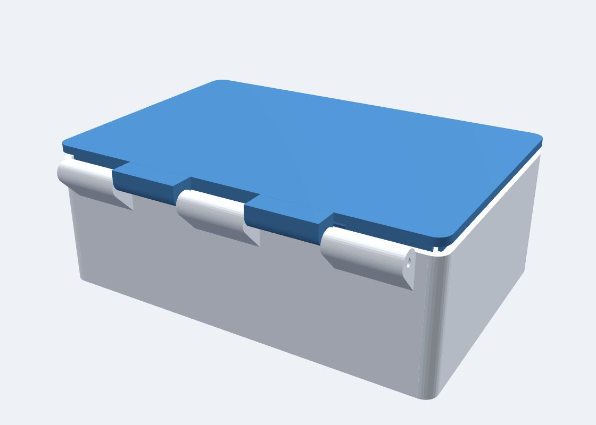

## 0.49.0

Project boxes: Arrange it for me works with rooms, and dividers can stand on a level.

- **Arranging in rooms:** with dividers in the box, every board is put inside a room, never across a divider, the main board in the room by the walls its ports face. The smallest box moves its dividers with it.
- **Dividers on a level:** a divider can stand on level 1, 2 or 3, in a groove printed on the level, as well as on the floor.

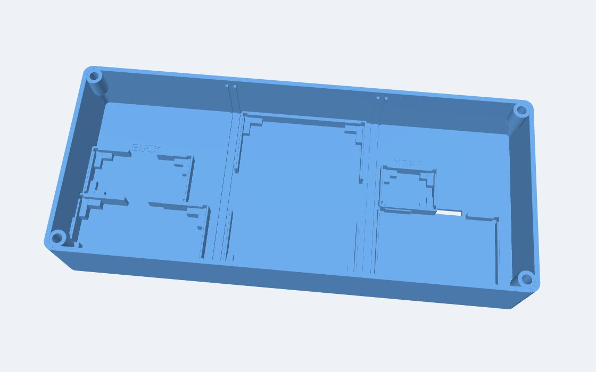

**Fixed**
- **Arrange it for me** ignored the dividers, so it could put a board right across one.

## 0.48.0

Project boxes: a parts list, a floor to screw things to, names on the floor, and printed extras.

- **What you'll need:** the screws (with their lengths), heat inserts, magnets, rubber feet, straps, fans and boards your box takes, in one list you can copy.
- **Mounting holes in the floor:** a grid of 3.2 mm holes wherever nothing else is, for whatever you add later.
- **Board names on the floor:** each board's name engraved beside it, so they go back in the right place.
- **Printed extras:** snap-in covers for the cable channels, spacers of any height, and zip-tie mounts that screw down.
- **Snap catches** for a press-fit lid: bumps on its lip click into grooves in the walls.
- **A finger pull** to lift a press-fit or magnet lid, and **your own battery size** for a pack that isn't in the list.
- A hint when a warm part (a power supply, a converter, a Raspberry Pi) is in a box without a vent or a fan.

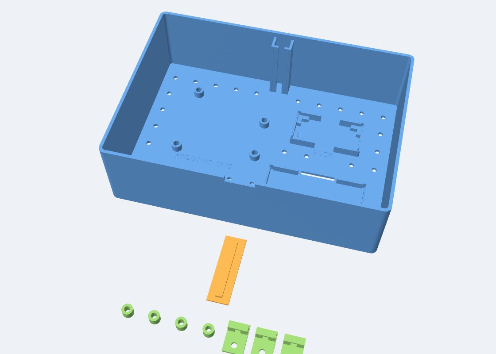

**Fixed**
- The battery's note on the Make tab still described the four corner fences from before 0.46.

## 0.47.0

Project boxes: art, words and icons on any face, engraved, inlaid or raised.

- **Art, words and icons on the box:** a name, a word, any of the 54 icons or the Art tab's picture on the lid, the floor, the front, the back or a side. Each one can be engraved, inlaid flush in another filament, or raised on a wall, at the size and place you choose, upright or turned, in any of the app's fonts.
- **Label every opening:** one click names each opening (USB-C, HDMI, DC IN, ON/OFF, PUSH, LED…), engraved under it.

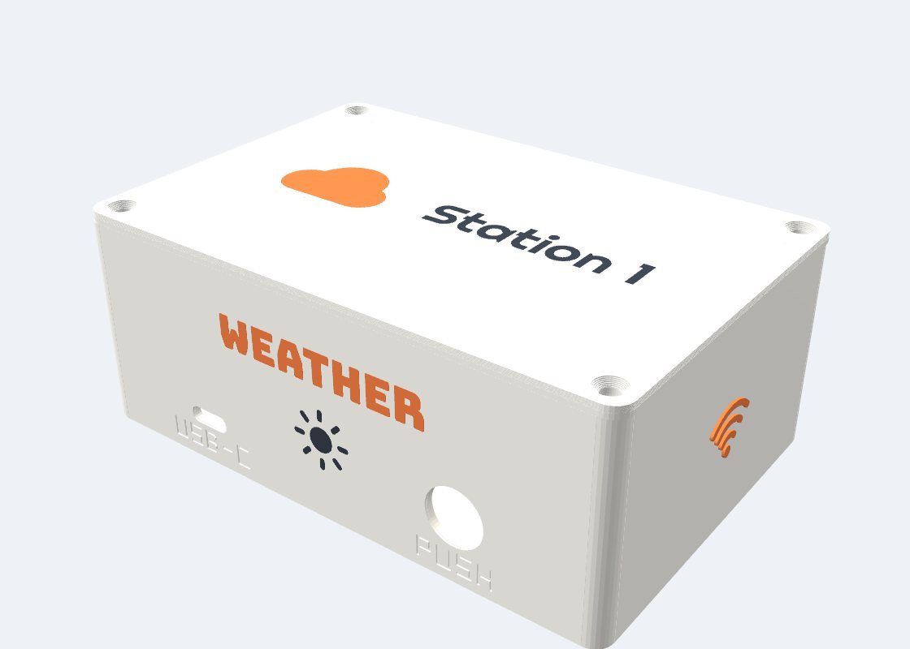

## 0.46.0

Project boxes: screw mounts you can move, so the bottom floor is free, and neater holders for boards and batteries.

- **Levels held your way:** posts in the corners, **screw brackets on the side walls** (nothing on the floor under them), **posts where you put them** (two to six, in the gaps between your boards), or ledges.
- **Short lid posts:** only the top of each corner screw post, over a 45° cone, so boards can go right into the corners.
- **Neater holders:** a board's cradle and a battery's strap tray are one low rim with rounded corners now, with finger gaps (and gaps for the strap), instead of four separate L-shaped corners.
- A board under a post or a bracket is named, and **Arrange it for me** keeps boards clear of them.

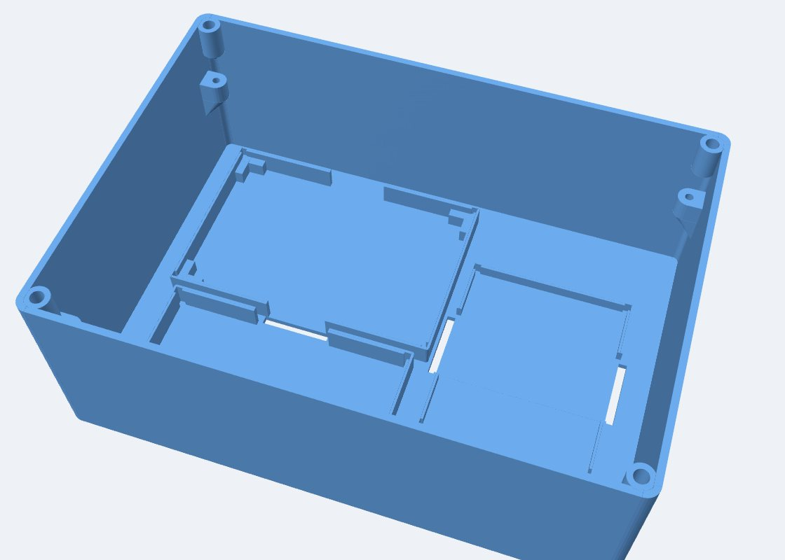

**Fixed**
- With two levels on posts, the upper level's posts ran through the lower level, so it couldn't go in. They now stand on the lower level.
- A board on the floor could sit where a level's post stands without a warning, and **Arrange it for me** could put one there.

## 0.45.0

Project boxes: every floor for mounting, batteries of all sizes, rooms, and cables between the floors.

- **Floors 2 and 3:** the main board can go on a level too. Each level can have a grid of 3.2 mm mounting holes (every 10, 15 or 20 mm, wherever nothing else is), zip-tie anchors, and its own cable pass to the floor above: a slot at the back, front or a side, or a hole in each corner, small or large.
- **Batteries:** 38 now, from tiny LiPo pouches to wide 5000 and 8000 mAh ones, RC packs (2S 1300 to 4S 5000), 18650 holders for 1 to 4 cells, 21700, 26650, AA, AAA, C, D, coin cells and lead-acid. Each lies in a **strap tray**: corner fences and slots for a hook-and-loop strap (or zip ties), on the floor or on a level.
- **Cable channels up the walls:** C-shaped ducts on the inside of a wall from the floor to the top, the levels notched round them.
- **Rooms:** two, three in a row or four in a cross in one go; dividers that cross slot into each other; a choice of cable notch (small, large, one at each end, or none).

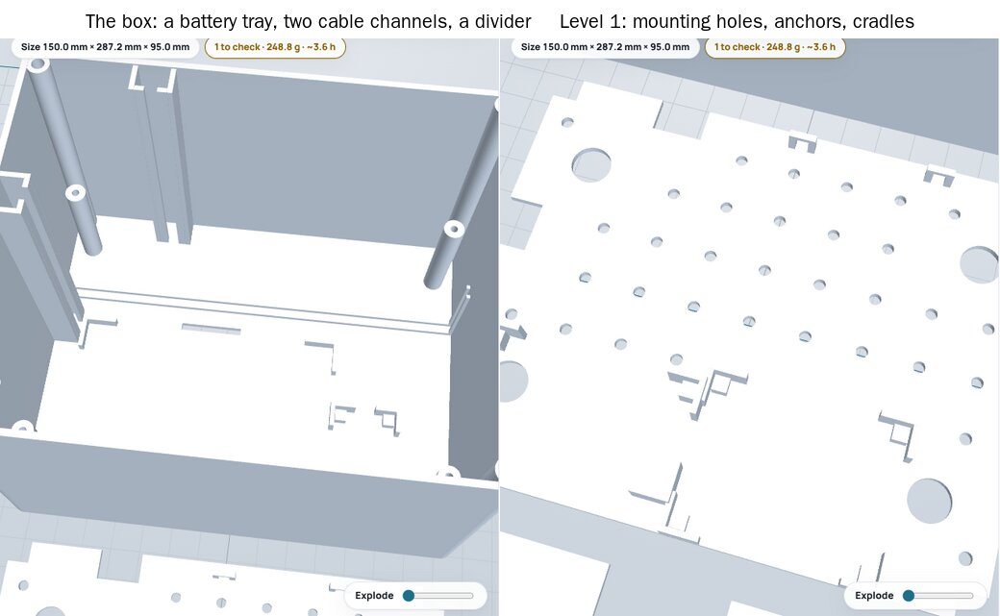

**Fixed**
- A board on a level next to a wall had its cradle hanging over the level's edge, which needed support; the wall holds it there now.
- **Arrange it for me** with a sliding lid could put a board's ports above the front wall, so their openings were left out; the box is now tall enough under the lid.

## 0.44.0

Click to colour: fix or colour a model from its photo by clicking on the parts.

- **✨ Click to colour** on the Paint tab's photo card: click a part of the photo (the shirt, the hair, a boot) and an AI (Segment Anything, 14 MB, downloaded once, running on your computer) outlines it. Click more of it to add, or leave a bit out; then **Paint it** in a filament and that part of the model takes it.
- **Right through** paints the back of that part as well, as seen from straight behind: a shirt from a front photo, front and back.
- Each outline is a step on the Paint list, kept with the project (it opens offline), and it follows the photo when the photo is lined up again.

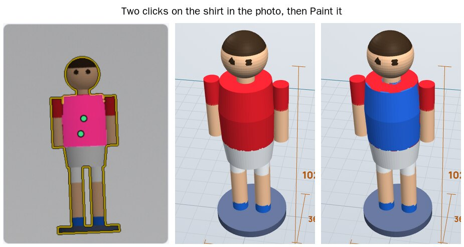

**Fixed**
- No bug fixes in this release: the new tool was tested on the photo test's figure with the real AI, in Node and in Chromium.

## 0.43.0

Move freely while you paint, a multicolour icon maker, and project boxes filled in from a description, with optional AI help.

- **Moving while you paint:** no more switching to Turn view. Drag beside the model to turn it, right-drag or hold **Space** to turn it anywhere, drag with the middle button to slide it. On a touch screen one finger beside the model turns it, two fingers zoom and slide, and the new **✋ Move** button in the view frees it until pressed again.
- **Make an icon** on the Art tab: up to four of 54 simple icons on a badge (circle, rounded square, hexagon, shield or none), each in its own filament, with an optional ring and a word underneath. Ready-made ideas, a searchable grid, and a gap that keeps a small icon on a big one readable. On a project box it is inlaid into the lid.
- **Describe your project** on a project box's Make tab: type what goes in it and the boards are arranged in the smallest box that fits your bed, the box grows for its openings, and each opening goes on a sensible face. Five ready-made descriptions to start from.
- **AI help (optional)** in Settings: your own Claude API key, or a free model on your computer with Ollama. **Plan it with AI** also picks faces, levels and a lid icon; **Design it with AI** makes an icon from a description. The AI answers only with names from the app's lists, and everything is checked before use. Only the words you type are sent.

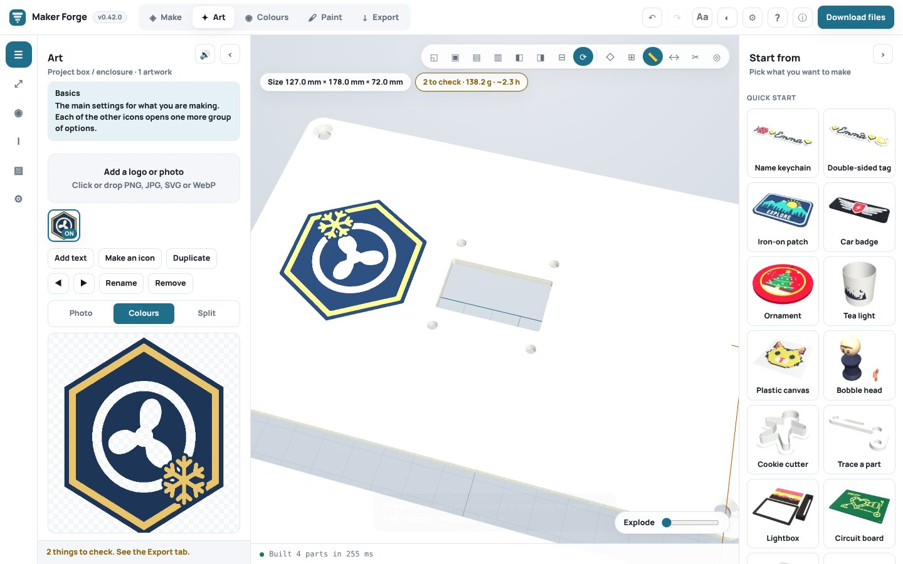

**Fixed**
- A brush stroke started straight after turning the view slid under the brush while the view glided to a stop; the view now stops the moment you start painting.
- Two fingers on a touch screen painted a dab before zooming; a stroke just begun is now taken back when the second finger lands.
- **Arrange it for me** could make a long, thin box (65 × 152 mm) to save a little floor; it now prefers squarer boxes.

## 0.42.0

Project boxes: **Arrange it for me**.

- **Arrange it for me (smallest box)** in **Board mounts** packs every board and module on its floor (or its level), 3 mm apart, each turned whichever way packs best, and makes the box as small as that allows while still fitting your printer's bed. The main board goes against the walls its ports face, and its port openings move with it. The height follows the tallest part.
- **Arrange in this box** does the same without changing the box's size, or says it is too small and suggests the first button.
- Boards stay clear of the corner screw posts. Undo puts everything back.

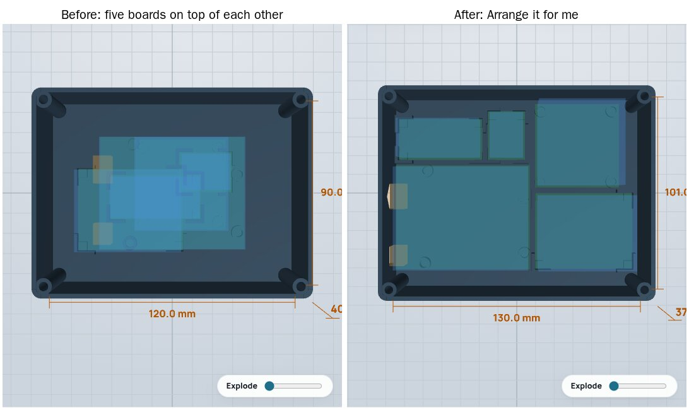

**Fixed**
- No bug fixes in this release: 60 random sets of boards were arranged and built with nothing overlapping, on a post or outside the box.

## 0.41.0

Project boxes that print without support.

- **Pointed tops by themselves:** a port opening in a wall whose top would be a bridge longer than your printer's bridge limit (a USB-A port, an Ethernet socket) gets a 45° pointed top. Each opening's top is **Auto**, **Flat** or **Pointed**; openings in saved projects keep theirs.
- **Fan grilles of slots:** upright slots with pointed tops inside the fan's circle, now the default. Rings and honeycomb are still there.
- **Honeycomb in a wall** uses flat-topped cells: each top is a short bridge instead of a shallow roof.
- **Vent slots in a wall** have pointed tops.

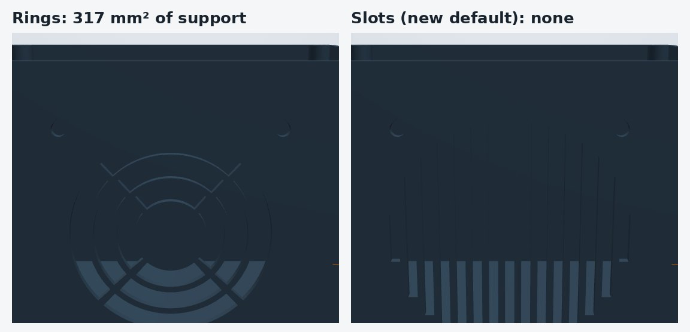

**Fixed**
- The PSU box quick start needed about 630 mm² of support (its fan grille, vents, inlet and switches); it now needs about 184 mm². What's left is under the IEC inlet, the rocker switch and the meter, whose flat tops stay hidden by their bezels.
- A USB-A port, a fan grille or a honeycomb vent in a wall needed support; they print without now. The power bank box quick start went from 73 to 47 mm².
- A fan's screw holes in a wall needed a little support; they are teardrops now (hidden by the fan).
## 0.40.0

Project boxes: the inside. Levels, dividers, a fan inside, and your parts shown in place.

- **Your parts shown inside, see-through** (not printed): each board, the room its parts take and its ports. The box now warns when parts reach the lid or a level above, and names a board's port with no opening in front of it.
- **Levels** (a second floor, up to three): a shelf at the height you choose, printed flat as its own plate. It stands on four posts it screws to, or rests on ledges along the side walls. A slot for cables and air slots are options. Extra boards and modules can go **on a level**, their standoffs or cradles on its plate.
- **Dividers** (up to four): plates that slide into grooves on the walls and floor, across or front to back, printed flat. Each can hold a **fan** (40 to 140 mm, with its grille and screw holes) and have a cable notch. A 120 mm fan in a divider blows from one room to the other.
- **Zip-tie anchors** on the floor, along the back, the sides or all round, keeping clear of boards and posts.
- When the box, lid, levels and dividers don't fit one bed together, each goes on a plate of its own and the print check measures each.

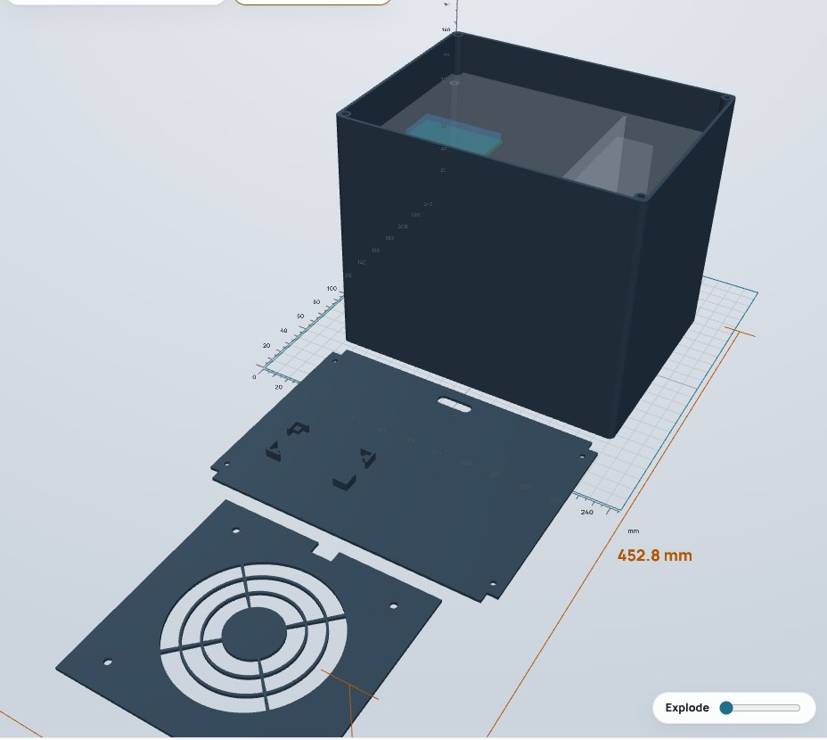

**Fixed**
- No bug fixes in this release.
## 0.39.0

Project boxes: many more parts, and boards held the way they need.

- **Over 60 boards and modules** in **Board mounts**: Arduino, Raspberry Pi, ESP32 and ESP8266 boards, Teensy, STM32, Feather, micro:bit; converters, chargers and Mean Well supplies; relays and motor drivers; sensors, readers, radios and amplifiers; battery holders.
  - A board with holes sits on standoffs. One without holes sits in a **cradle**: a seat under each corner and a low fence round it, so it drops in. **By its edges** uses a cradle for any board.
- **Several boards in one box**: **Add another board or module** (up to 12), each with its own place, height and mounts. Two that overlap are named.
- **Add this board's ports**: the board slides against the walls its ports face, and an opening goes in for each port at the right height (Arduino, Raspberry Pi, ESP32 and ESP8266 boards, XIAO, Teensy and others).
- **76 more openings** (about 150 in all): USB-B, micro- and mini-HDMI, keystone jacks, D-sub and XLR with their screws, antenna and aviation connectors, fuse holders; more buttons, slide-pot slots, a footswitch; LED rings, sticks and strips; e-paper and more TFT screens, the Pi 7-inch touch screen; gas, distance and light sensors; speakers from 40 to 77 mm; cable glands.
- **A search box** over both lists: type "esp8266", "neopixel" or "gland m20"; Enter adds the first match.

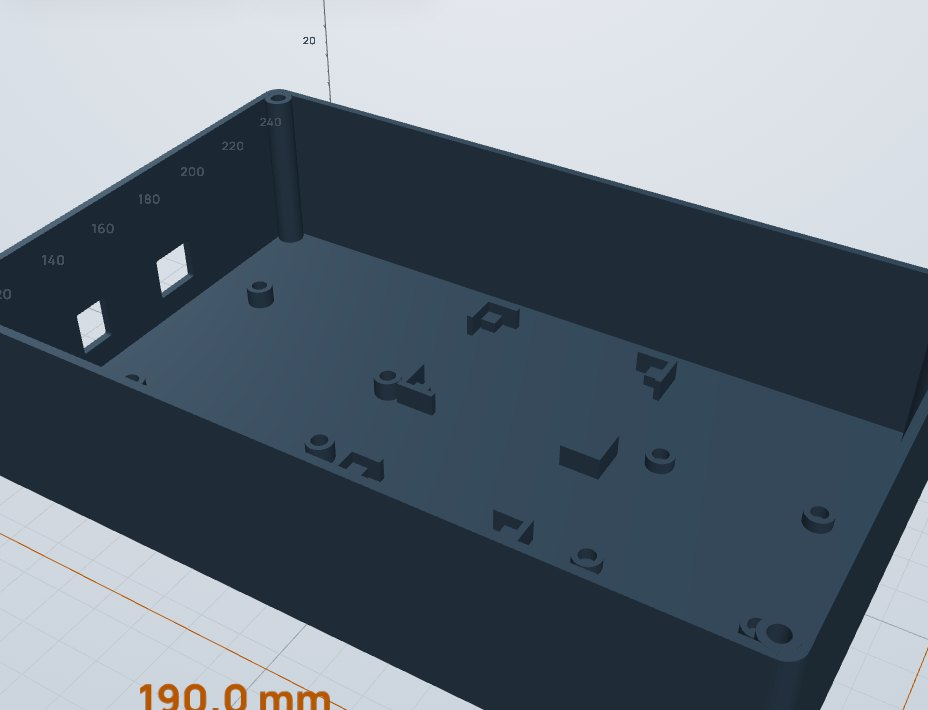

**Fixed**
- No bug fixes in this release: 120 random boxes with the new boards, modules and openings, built in a real browser, came out clean.
## 0.38.0

The tracer and the photo relief, updated, and imported models kept in your browser.

- **Edges on a traced part** (step 5, **Shape it for printing**):
  - a **chamfered** or **rounded** top edge, so the part is nicer to hold;
  - a **bottom chamfer** (0.3–0.5 mm): the first layer's squish (elephant's foot) no longer makes a part traced to fit too big;
  - **Countersink the round holes**, so flat screw heads sit flush. A clearance hole for an M2 to M4 screw takes that screw's head.
- **A photo relief in the photo's colours**: its face is painted with the loaded filaments nearest the photo, and the border, sides and back stay in the relief's own filament.
- **A stand for a photo relief**, to put it on a desk.
- **Imported models are kept in this browser**: a model comes back with your saved work and from the recent list, instead of asking for the file again. The last four are kept, up to 300 MB, and never leave your computer. **Clear saved work in this browser** forgets them.

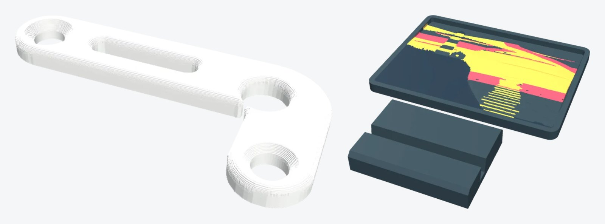

**Fixed**
- Opening your saved work, or a project from the recent list, made with an imported model asked you to open the model's file again. It now comes back by itself (in the same browser).

## 0.37.0

Signs, plaques and photo frames, updated: a real frame for a photo, and stands.

- **A frame for a photo** (the **Frame for a photo** quick start, or **For a photo** on a photo frame):
  - pick the photo's size (wallet, 9 × 13, 10 × 15, 13 × 18 cm, A6, A5, square or your own), upright or sideways, and how wide the frame is round it;
  - the photo and a clear sheet go in from the back and a back panel presses in after them;
  - the window's edge is bevelled at 45° like a mount board, so nothing needs support;
  - a stand that plugs into the back, and keyholes to hang it on two screws.
- **A stand to hold it up** for a plaque, a frame without a photo and a sign on a board (a desk sign): a low base with a slot, leaning it back 10°.

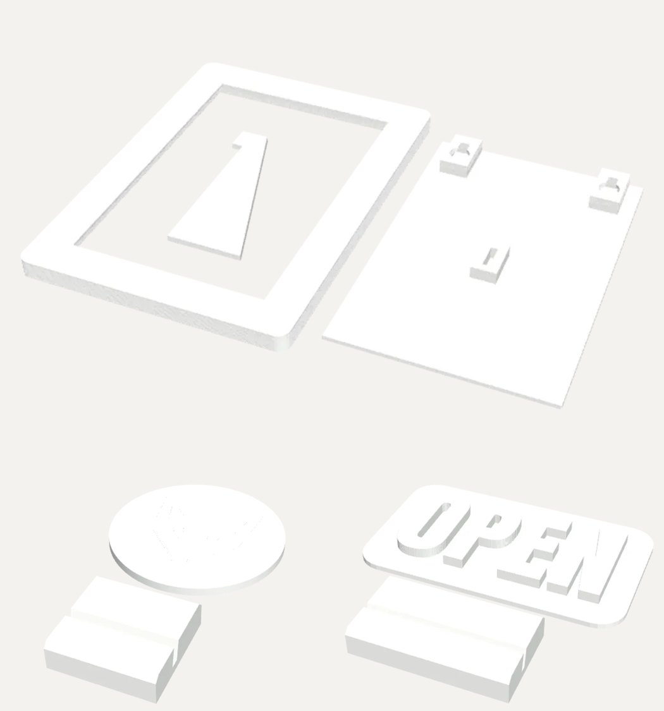

**Fixed**
- Nothing broken turned up in signs, plaques or frames this time (110 random builds of each, checked in a real browser).

## 0.36.0

The name keychain, the double-sided tag and business cards, updated.

- **A magnet in the back** of a name keychain or tag (**Magnet** page): a pocket for a 5 to 12 mm round magnet, so the name sticks to a fridge, a whiteboard or a toolbox. One or two, placed where the plate is deepest; the magnet is glued in after printing.
- **Your own text on the back** of a double-sided tag, such as "If found, call…" or a second name, instead of the mirrored name. It is set flush into the back and sized to fit.
- **A tagline** on business cards, under the title.

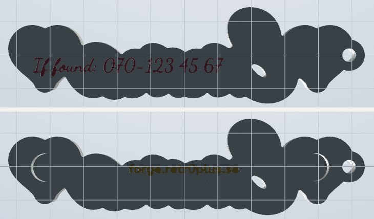

**Fixed**
- The credit on the back of a keychain was left out ("too big to fit") on many names, script names especially. It was only ever tried at the middle of the name's outline, which is often a narrow neck or a gap. It now goes where it fits, nearest the middle.
- On a business card in a font with capitals only (Bebas Neue, the default, or Bungee), **Name in capitals** did nothing. The switch is replaced by a note with those fonts.

## 0.35.0

Paint that ends exactly where you painted it.

- **Sharp edges** (on the Paint tab's **Paint detail** page, on unless you turn it off):
  - Each brush stroke, eraser stroke, box or lasso and painted picture is cut into the model. A colour now ends exactly where you painted it, instead of at the nearest triangle.
  - A round dab prints round, a stroke's edge is smooth, and a picture's colour edges run where the picture's do, even with coarse paint detail.
  - The download carries the cut model, so the slicer shows the same edges.
  - A big model is cut a moment after you stop painting, and always before a download.
- **A stroke follows the line you drew**, so a fast stroke no longer leaves gaps between its dabs.
- **Painted pictures are read finer** (240 pixels across instead of 160) when Sharp edges is on.

**Fixed**
- A double-sided tag's back name stood below the plate, so the plate printed in the air round the letters. The name is now flush in the back, in its own filament, and the tag lies flat (**Back letter height** is now **Back letter depth**).
- The print check said a print needed no support when part of it reached below the bed, as that tag did.
- Letters set into the back of a tag (the double-sided name, the credit) left slivers of plate thinner than the nozzle between close strokes; those gaps are filled now.

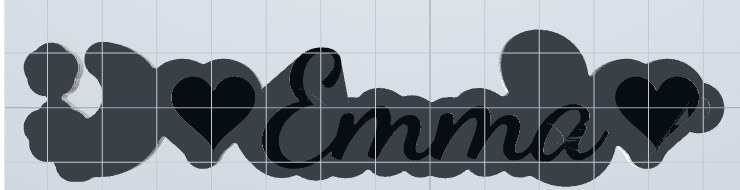

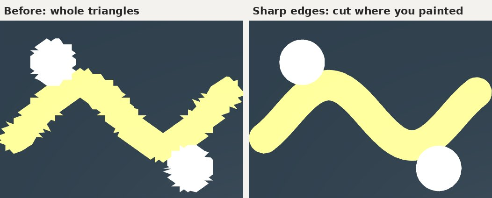

## 0.34.0

A project box bigger than your printer's bed is now made in parts that screw together.

- **Split into parts** (Make tab, project box). A box longer than the bed is cut across its longer side into parts that each fit, and the lid with it.
  - Inside each join both parts have a flange: heat inserts in one, clearance holes in the other, M3 screws (or M2, M2.5, M4) through from inside.
  - With a screwed or magnet lid the flanges also take two more lid screws or magnets each side of every join, so each part of the lid holds down on its own.
  - The joins move to keep clear of openings, labels, posts, standoffs, the board and the mounts (ears, tabs, loops, hooks). When one can't, the app names the opening in the way. Ears or loops that stick out count in each part's size.
  - **When it's bigger than the bed** is the usual choice; **Always** splits even a box that fits, into 2 to 8 parts; **Never** keeps it in one piece.
  - The page says how the parts go together, how many inserts and screws you need and how long the screws are, and what prints on each plate. **⊞** lays the parts out on their plates, and the download has a 3mf for each plate, an STL for each part and `how-it-goes-together.txt`.
  - The parts need no more support than the one-piece box: the screw holes have pointed tops.
- **Before you print** checks each plate of a box in parts against the bed. For a box bigger than the bed with splitting switched off, it says the box can be made in parts.

**Fixed**
- No bug fixes in this release.

## 0.33.0

Many more openings for project boxes, and ways to mount them.

- **About 30 new openings**, and **Add an opening** now lists all of them in groups (ports and power, buttons and switches, lights, screens and meters, sensors and cameras, sound, fans and vents, mounting and your own sizes). Among them:
  - an **ESP32-CAM** (or XIAO ESP32-S3 Sense) camera lens, and a Raspberry Pi camera with its screws;
  - **motion sensors**: the HC-SR501 dome with its two screws, and the mini AM312 / HC-SR505;
  - the HC-SR04 distance sensor's two eyes;
  - a **USB-C charging board's** port (TP4056 and IP5306 type), a DC jack on a board, XT60, a 3.5 mm audio jack and an SMA antenna socket;
  - slide switches, rotary encoders, key switches, a joystick, 30 mm arcade buttons and big toggles;
  - 0.91 and 1.3-inch OLEDs, TFT screens, an LED matrix, 4-digit displays and a volt and amp meter;
  - light, IR, temperature and microphone holes, and **speaker and buzzer grilles**.
- **Mounting** for project boxes (none of them need supports):
  - **Screw ears**, two or four.
  - **Hanging tabs** rising above the back, with a slot for a screw or nail.
  - **A DIN rail clip** that screws under the floor.
  - **Strap loops** on the back for a zip tie or a strap.
  - **Hooks for an IKEA SKÅDIS board**, and **pegs for pegboard**.

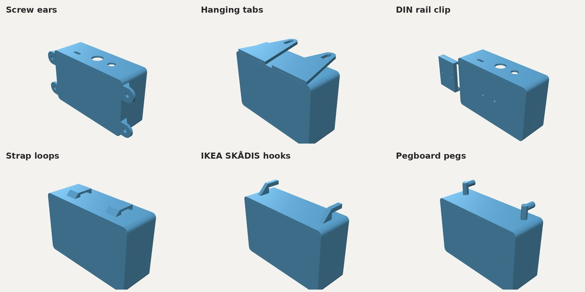

## 0.32.0

Signs, a 3D relief from any photo with AI depth, and a model doctor for imported models.

- **Signs** (a new object under **Personalise**, and the **Light-up letters**, **Neon sign** and **House number** quick starts):
  - **Solid letters**, with keyholes or pin holes in their backs.
  - **Lit letters**: hollow, for an LED strip round the inside, with faces that print flat in white and drop onto a ledge (sloped at 45°, so no supports), a hole in each for the wires and a keyhole to hang it.
  - **Neon style**: a groove for silicone LED neon strip along each letter, on a board.
  - Letters on their own, joined by a rail, on a board or on a board that follows the text. The panel works out how much LED strip you need.
- **A 3D relief from a photo** (a new object under **From a picture**, and the **Photo relief** quick start).
  - Press **Work out the depth with AI** and the app works out how near each part of the photo is: nearer parts stand higher, so a face, a pet or a landscape becomes a real relief.
  - The depth model (27 MB) downloads the first time it is asked for and is checked before it runs. It runs in your browser: photos are not sent anywhere. The depth is saved with the project.
  - Plaque, round, arch or heart, with a border and a hanging hole; or rising with brightness instead.
- **The model doctor** (an imported model's Make tab):
  - It says what is wrong with a model: holes, triangles the wrong way round, shells, flat or doubled triangles.
  - **Repair it** closes it up.
  - **Simplify** keeps the shape with a half, a quarter or a tenth of the triangles.
  - Paint and the model's own colours stay, and **Back to the original** undoes it.

**Fixed**
- An engraved name on a plate that came out in separate pieces lost its engraving: the plate stayed solid over the letters.

## 0.31.0

Parts that fit: gears, bolts and nuts, hinges, snap-fits and a fit test, replacement parts from your calipers, and a keychain with a surname and your credit on the back.

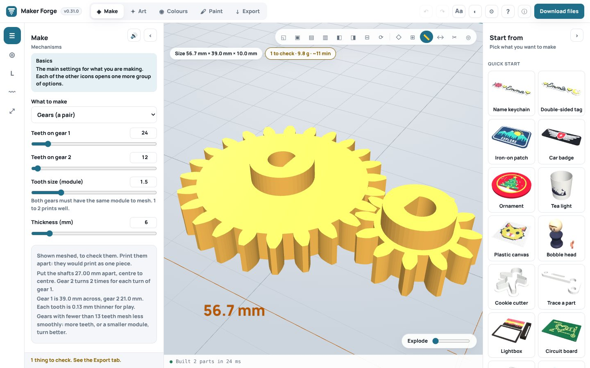

- **Mechanisms** (a new object under **Functional**, and the **Gear pair** and **Bolt and nut** quick starts):
  - **Gears**: a pair of spur gears with true involute teeth, any number of teeth and any tooth size. The panel says how far apart to put the shafts. Shaft holes can be round, D-shaped or hexagonal, with a hub. **Meshed, to check** shows them turning together.
  - **Bolt and nut**: ISO metric threads from M3 to M30, or your own diameter and pitch, with a hex head, a knob head or none. Both print standing, with no supports.
  - **Print-in-place hinge**: two leaves and their pin, printed already joined. Its knuckle holes have pointed tops, so they print without supports.
  - **Snap-fit clip**: two arms that squeeze through a slot and spring back behind it, printed flat so they bend without snapping.
  - **Fit test**: a peg and a plate of holes from tight to loose, each with its gap printed beside it. The first hole the peg slides through is your printer's **fit gap**. Set it once and every mechanism and fix-it part leaves that much play.
- **Fix-it parts** (a new object, and the **Replacement knob** quick start). Measure with calipers and type the sizes:
  - a knob (fluted, knurled, star or smooth) for a D or round shaft, or to grip a nut;
  - a leg cap or tube plug;
  - a shelf support (the pin prints lying down so it doesn't snap off);
  - a battery cover with tabs and a latch;
  - a cable clip for up to eight cables, with screw holes or a tape pad;
  - spacers and washers.

  Up to 24 at a time.
- **Keychains**:
  - **A second line** under the name, smaller: a surname. In a list of names, `Emma | Svensson` puts the surname on a second line.
  - **A credit on the back**: a short line such as your website, mirrored so it reads with the tag turned over, for keychains you give away. It is printed flush in a second colour in the first layers, or engraved. It shrinks to fit inside the edge and clear of the ring hole.

**Fixed**
- Engraved names lost the middles of closed letters: an engraved "Bob" came out as "Dob" with solid o and b.

## 0.30.0

Colour from a photo, far more accurate: the colours follow the model's own shape, and a photo whose figure stands a little differently is bent to fit.

- **Follow the model's shape** (under **Finishing**, on by default). The colours are worked out for the whole model at once instead of one little triangle at a time: edges between colours settle into the model's own folds and seams (a hem, a sock top, the line round a boot), and ragged edges and stray specks go. A big model still colours in a few seconds, in the background.
- **The sides a photo can't see take the colour on the other side of the same part:** the back of a leg from its front, the back of a sleeve from its front. They used to take the nearest colour.
- **Bend the photo a little to fit the model** (for each photo whose figure was found with the AI or fixed by hand, on by default). When the figure in the photo stands a little differently from the model, as in an artist's picture of it, the photo is bent by a few pixels so its outline meets the model's before the colours are read. The card says how much closer the outlines came.
- On the test figure a front photo alone now gets 91% of the surface right (85% before), and front and back together 98%.

**Fixed**
- The back of a figure coloured from one front photo came out as a patchwork of colours.
- Legs and arms came out with grey patches where the photo's pose differed a little from the model's.
- The top of a figure's base, seen at a low angle in the photo, came out in streaks.
- Colour edges came out ragged, with specks of other colours along them.

## 0.29.0

Pictures: backgrounds taken away properly, and pictures that print the size and shape you drew them.

- **✂ Take the background away.** A logo or drawing on one plain colour now loses its background by that colour: straight away, with nothing to download. Inside the letters too, with smooth edges in the picture's own colours. **Inside it too** or **Only round it**, and **How different a colour can be and still go**, change it, and **Put the background back** undoes it. On the Art tab and beside a keychain's name.
- **A badge or sticker:** once the background is gone, the patch of colour the picture sits on can go too (**Take the green round it away too**), leaving only what is on it.
- **The AI cut-out falls back on the colours.** When it finds no subject in a picture on a plain colour, or can't be downloaded, the background is taken away by its colour instead. On a plain background its edges now come from the colours, sharper and with no rim.
- **Pictures wrap round round objects.** On the side of a cylinder, a sphere, a round pen pot or a vase, a picture goes round it like a label: its width measured round the curve, its height along the side. **Project it straight on** is still there to choose, and wrapping can be chosen on imported models too.
- **Width and Height.** A picture's height can be set too, and the width follows (a name 12 mm tall). New text is trimmed to its letters, so its width and height are the letters' own.
- **Take this colour away too:** once a picture's background is gone, any of its other main colours can go as well, everywhere in it.
- **Only the background is left out.** The colour round most of a picture's edge is its background: it prints nothing and the preview shows it see-through. Every other colour now prints right up to the picture's edge. **Print the background too** prints it as well. A picture with a see-through edge already (a cut-out, a PNG logo) has nothing left out, and a picture that is all background says so.
- **Jigsaw pictures:** a strip of a colour thinner than the nozzle takes the colour beside it, instead of printing as a sliver.
- **Fine detail is kept.** Lines two steps of the **Edge quality** wide print at their full width, and small dots, like the dot on an i, are kept.
- **Colour from a photo:** when the AI figure finder finds no clear figure in a photo, the outline found by its colours stays, and the card says so.

**Fixed**
- The AI cut-out found "no clear subject" in a logo on a plain colour (white letters on green) and left the background on.
- Colours touching a picture's edge were left out of the print (a flag, a sky, a letter at the edge), though the preview showed them.
- A rim of a third filament ran round letters and shapes where two colours meet: black lettering on white printed with a teal or red outline.
- Lines two cells wide printed a quarter too thin, and small dots were lost.
- On cylinders and other round objects, the edges of a picture came out up to 43% wider than drawn.
- A keychain's picture kept a thin rim of its background colour round it.
- Colour from a photo: when the AI found no figure, the photo lost its outline altogether.
- In the Split preview of a mirrored picture, the photo half was the wrong way round, so a click there could leave out the wrong colour.
- A cut-out picture's soft edge counted towards its width, so it printed a little smaller than set.
- New text came out about 5% narrower than its width said: the width included a margin round the letters.
- A logo on a clear background that filled its picture (rounded corners, an app icon) lost its main colour, taken for its background.

## 0.28.0

Business cards: printed in colour, with QR codes you can scan straight off the card, and an NFC tag sealed inside if you like.

- **A new object: Business card** (also a quick start). A bank card's size by default (85.6 × 54 mm), or European, US, Japanese, Australian, square, mini, a bag tag or your own size, lying or upright.
- **Your name, title, company and up to 8 lines of details,** each line with a small icon picked from what it looks like (phone, email, web, @handle, address). Two fonts, sizes, capitals, spacing and alignment. Five layouts: words left and code right, the other way round, centred, a band holding the logo and the code, or just the name (the rest on the back).
- **QR codes on the front, the back or both,** each with its own job: a web address, a contact card made from your details (a phone saves you with one tap), a call, a text message, an email, Wi-Fi or any text. Square, rounded or dotted, with square, rounded or round corner eyes, and your initials in the middle if you like. The app picks the strongest error correction that keeps the squares printable and says how big they come out; a light patch goes behind a code on a dark card; it warns about a code that is too fine, too pale or the wrong way round.
- **A logo:** the picture from the Art tab in its own colours or one, or your initials in a circle, hexagon, diamond, square or shield.
- **Flashy:** a border (line, double, thick frame, corners, dashes, dots), a band of colour with a straight, slanted, wavy or curved edge, and 15 patterns (stripes, chevrons, honeycomb, waves, banknote guilloche, contour lines, a sunburst, carbon weave, circuit traces, confetti and more), over all or part of a face, fading across it, kept clear of the words and the code.
- **Prints flat in one go.** Face down by default: the front is flush in the card's first layers, as smooth as the bed. The face on top is flush, raised or engraved. For one-filament printers, everything raised in one colour needs a single swap.
- **An NFC tag inside:** a pocket for a 20 to 38 mm sticker, a coin tag or your own size, with a mark to tap. The card grows thicker if the tag needs room. Before you print, the Export tab and `nfc-tag.txt` in the download say before which layer to pause and drop it in.
- A keyring or lanyard hole, up to 12 copies on the bed, and a card for each name in a list.

**Fixed**
- Nothing from earlier versions this time.

## 0.27.0

Cutting: pictures and text engraved or inlaid into an object, and an imported model cut flat so it stands.

- **Engrave or inlay a picture or text into an object.** On the Art tab, **How it prints** now offers **Raised**, **Engraved** and **Inlaid**. Engraved cuts the picture into the surface, in the object's own colour. Inlaid cuts it in and fills it with the picture's colours, flush with the surface. **Depth** sets how deep. It works on every object a picture can go on, imported models too: a name in the side of a figure's base, a logo inlaid in a box or a vase.
- **Cut an imported model flat.** **Cut it flat** on the Make tab cuts off the bottom of the model, so it stands on a flat face: a bust, or a figure on round feet. Paint and pictures stay where they were on the model.
- An imported model keeps its own colours and painting through a cut: the walls and floor of an engraving, and a new flat bottom, take the colour round them.
- The cutting tool (Manifold, 0.6 MB) downloads the first time it is needed, and is checked before it runs. **Before you print** says when an engraving is deeper than the model is thick, and when a model has gaps in its surface and can't be cut, with how to repair it.

**Fixed**
- The licence notes for the AI figure finder's model (`models/LICENSE.md`) ended with another project's copyright line.

## 0.26.1

Pictures in the back of a phone case, found from the owner's screenshots and a look at every phone.

- **A phone case turns over by itself when its back has a picture,** so you see the picture. It prints face down on the bed, so the right way up it was hidden under the case. The **⟳** button turns it back.
- **The Art tab shows a case's or a lid's picture in the colours it prints in,** and a click on a colour leaves it out. The preview was blank.
- **The app says when a picture won't come out well inlaid:** a photo (shading and fine detail are lost in a few filaments), or colours far from every loaded filament. It points to **Match to artwork** and the AI cut-out. These messages, and the case's others, now also show on the Art tab and under **Before you print**.
- **Phone cases no longer ask for supports for their button and port openings** when the slicer can bridge them. The print check now sees that the rounded ends of a slot hold its top, as any wall would. On the iPhone 17 Pro case the area flagged went from 115 to 68 mm²: what's left is the two right-hand button openings (15 and 17 mm, over the 10 mm bridge setting), and the message now says to leave supports off there.

**Fixed**
- On the Pixel 8 and 8a, whose camera bar runs right across the back, a picture in the back sat inside solid case: it looked shredded and flickering, and would have printed muddled.
- A part of a picture inside a gap of another (a dot in a ring, the middle of a letter) was covered by case or lid in the print. This affected phone cases and project box lids.
- Gaps between two colours of a picture narrower than the nozzle left strips of case or lid too thin to print (0.19 mm between the cells of a honeycomb). They now take the colour beside them.
- The "Fine detail is thinner than the nozzle" check also warned about pictures that were switched off.
- **Match to artwork** with a picture in a case's back or a box's lid turned the case itself into one of the picture's colours (a black case became white) and spent a filament on the picture's background. It now keeps the case's filament, leaves the background out and names the other filaments after their colours. The photo message has a button for it.

## 0.26.0

- **Printers that load one filament at a time can print painted colours.** The Export tab's **Colour swap heights** now follows the paint too: each height band or stripe becomes a pause to swap the spool, given as the layer the slicer's slider shows. The print files include `colour-changes.txt` with the same list and how to add the pauses in PrusaSlicer, Bambu Studio and OrcaSlicer. A colour that only shares its layers with another (a spot of paint on the side of a vase) can't be printed that way, and the check names it.
- **Hide or name a paint step.** In the Paint list, **◉** hides a step for now (it is left out of the model and the print, and the Export tab reminds you), and **✎** gives it a name such as "Eyes" or "Hair".
- **Resizing an imported model is instant.** Its **Scale (%)** no longer rebuilds the model; the paint and any pictures on it grow and shrink with it. On a 373 000-triangle figure coloured from a photo, changing its size froze the page for 4.2 s; now for under a tenth of a second (measured in Chromium).
- Projects saved with an earlier version open the same: pictures placed on a resized imported model keep their size and place.
- **Colouring a big model from a photo freezes the page less.** Finding the light in the photo, evening it out and reading the colours onto the model now happen on a helper thread, with exactly the same result. On the same figure, adding its photo froze the page for up to 2.4 s at a time (about 4 s in all); now about 1 s at a time (2 s in all), most of it getting the model ready for paint, which happens once. Changing the number of colours: 1.0 s → 0.35 s.

**Fixed**
- **The print files could keep the paint from before.** After a paint change that left the model's shape alone (a fill, a box or lasso, recolouring, Undo, a height band's colour, Auto colour settings, the colours from a photo), the downloaded files, the colour-change count and the swap heights still had the earlier paint, while the 3D view showed the new one. Brush strokes came through. This was there since version 0.17.
- On a one-filament printer, the colour swap heights left out painted colours (height bands, stripes), and listed a colour that comes back higher up only once.
- Those heights were where each part starts. For a name sunk into its plate that is below the plate's top, so the swap came too early and the top of the plate printed in the name's colour. The swap now comes at the first layer above the plate.

## 0.25.2

A bug hunt: every setting of every quick start and object tried at its lowest and highest in a real browser, every tab and section tapped on a phone-sized screen, and the owner's own way of working (import a figure, colour it from a photo) on a copy of the Maker Forge website. All of them came through without an error; these are the problems found on the way.

**Fixed**
- On a website that does not allow helper threads (such as the Maker Forge page on retr0plus.se), lining a photo up with a big model froze the page for up to 5 seconds at once; it now pauses between steps (2 s at most, as in the downloaded file).
- On a website that blocks downloads from other sites, the AI figure finder could not load its engine. It now looks for it in the `models` folder next to the page first, and the message says which files go there.
- "Bigger than the print bed" measured the parts where the view showed them, not where they print: a layered lightbox laid out wider than the bed passed the check, and **Explode** could make a model that fits look too tall.

## 0.25.1

- **Much less freezing.** Building a model now does the same work in far less time, and takes short breaks so the page keeps responding. Measured in Chrome on every quick start, the longest freeze while opening one and while moving its first slider:
  - Name keychain: 2.8 s → 0.4 s to open, 1.4 s → 0.3 s per slider change;
  - Double-sided tag: 1.2 s → 0.25 s, 1.2 s → 0.23 s;
  - Kids' puzzle: 3.4 s → 0.3 s to open;
  - Lithophane: 1.7 s → 0.2 s to open, 0.8 s → 0.3 s per slider change;
  - Trace a part: 0.8 s → 0.2 s, 0.5 s → 0.2 s;
  - Plastic canvas: 0.7 s → 0.1 s, 0.7 s → 0.1 s;
  - over all 22 quick starts, the longest freeze is now under half a second (it was 3.4 s).
- Opening a quick start no longer builds the model twice when nothing changed in between (puzzles, lithophanes, boxes, phone cases).
- Pictures are kept with your project in the background instead of while you wait, and a big model's closed-mesh check is about seven times quicker.
- **Big imported models** freeze less too. On a 373 000-triangle figure coloured from a photo:
  - adding the photo: 3.1 s → 2.1 s;
  - opening the Export tab: 0.7 s → 0.2 s;
  - changing a picture's width: 0.9 s → 0.6 s.

  Changing such a model's size still freezes for about 4 seconds; that is next.

**Fixed**
- On a website with strict security settings, such as the Maker Forge page on retr0plus.se, and so on phones visiting it, every model failed with "Cannot read properties of undefined (reading 'coverageField')". The app now starts there too; downloading `index.html` always worked.
- The plastic canvas printed its picture twice: as stitches and again as a flat picture laid over them.
- On a plastic canvas, each hanging hole overlapped a stitch hole, which left slivers of plastic inside the hanging hole.
- On a plastic canvas with **Leave the background open**, the open squares overlapped the stitch holes and the panel came out jumbled; the open squares now keep the bars between them, like real canvas.
- A plastic canvas with many stitches took seconds to build (3.5 s at 90 across); now about 0.4 s.

## 0.25.0

- **Pick any earlier version.** Every version is now on the [Releases page](https://github.com/Retr0Plus95/Maker-Forge/releases) as a file to download and open, with what changed in it. The About dialog (ⓘ) links to it.
- **No long freeze while a photo is lined up.** Lining a photo up with the model now runs on the helper thread. On a 370 000-triangle figure the page used to freeze for 7.5 seconds; now it stays usable, with at most 2 seconds of freeze while the colours are painted.
- **More accurate colour from a photo.** On five test product photos (lit hard from one side, taken from close by, a grey copy of the figure behind), the parts each photo shows came out 94.5% right instead of 91.8%, and the whole figure 80.6% instead of 76.9%.

**Fixed**
- A model with artwork on it could stop building, with "Could not build the model: Cannot read properties of undefined". Artwork that cannot be laid on the model is now left out, and the message says which and why, so the rest of the model still builds.
- Black paint in half shade (hair, boots) took the colour round it, like the socks' red, when colouring from a photo.
- Red in deep shade could still take a filament of its own when the light came from the other side, pushing out another colour, such as the hair's.
- A second figure standing against the first in a photo pulled the line-up off by up to 10°.

## 0.24.2

- **Bambu Studio's message about our files, explained.** Opening the Bambu 3mf as a project, Bambu Studio says *"The 3mf is not from Bambu Lab, load geometry data and color data only"*. Its own source code shows it says this about every 3mf made by another app; the model, its paint and each part's filament still load, and your printer settings are kept. To skip the message, drag the file in and choose **Import geometry only**. The Slicer notes, the notes in the download and the manual now say so.

**Fixed**
- On a phone, the Export tab's last four section buttons (Share a link, Project file, Slicer notes, Help) and the Make tab's last one sat past the edge of the screen; the buttons now wrap onto a second row.
- The export notes said Bambu Studio takes the filament colours from the file. It doesn't for files from other apps: it keeps the filaments you have set up.

## 0.24.1

- **More accurate colour from a photo**, worked out on a real case: a figurine of a footballer in a red and green kit and its product picture, where the shaded half of the shirt, arms and legs came out green, the face partly green and the top of the base in stripes.
  - **Light and shadow are evened out.** The app finds where the light came from, using the model's own shape, and takes the shading out before it reads the colours, so the red in shade is read as red. Shades of a strong colour no longer take a filament of their own, and pixels too dark to read are left out. The photo card says where the light came from. **Even out light and shadow** turns it off; projects saved before this version keep it off.
  - **Other things in the picture are left out of lining up**: icons and labels beside the figure, and a second figure standing behind it, which the AI figure finder marks too.
  - **The angle is looked for both as from far away and as from close by**, then how close. The footballer's picture now lines up from the front with the outline matching 85%, where it lined up as from 22° to the side at 71%.
  - On five test photos lit hard from one side and taken from close by, the parts the photo shows came out 94% right instead of 81%.

**Fixed**
- The top of a base seen from a little above was guessed from its front, which painted it in stripes; it is now read from the photo.
- Along the edges of a figure found by the AI, the background was read as a colour (grey along arms and legs).
- **Line it up again** and the side buttons did not read the colours again, so after hand fixes a colour could be left out.
- Finding the figure by colour lost it in front of a busy background more often than it needed to: on a test photo in front of a bookshelf, 76% of the model now comes out right instead of 54%.

## 0.24

- **Close-up photos.** When colouring a model from a photo, a phone held near a small figure makes its near parts look bigger, and the photo did not line up well. Now the app works out how close the camera was as it lines the photo up, and allows for it. On rendered close-ups of the test figure (the camera 1.7 and 2 times the figure's height away), the share of the surface coloured right went from 65% to 84% and from 68% to 87%. Photos from far away line up exactly as before.
- **How close was the camera?** on the photo card shows what was worked out, and lets you choose **Far away or zoomed in**, **Arm's length** or **Close up** by hand. It is saved with the project.

**Fixed**
- Colouring from a photo taken close to the model lined it up badly, so parts of the model took the wrong colours.

## 0.23

- **Faster and lighter.**
  - The 3D view is drawn only when something changes, instead of 60 times a second, so a Maker Forge left open no longer keeps a laptop's or phone's graphics busy (and its battery and fan).
  - Finding the spot on the model under the pointer (the brush and its preview, Pick colour, measuring, placing a picture) now uses a tree of boxes round the triangles. On the painted vase (359 000 triangles) it takes about 0.015 ms instead of 4 to 15 ms, so the brush keeps up on big models, and on phones too.
  - The printability check runs on a helper thread (a Web Worker) made from the app itself, so the page stays free while it works. Where a browser cannot start one, it runs on the page as before.
  - The check that every part is a closed mesh runs once per part, not twice after every change.

**Fixed**
- Nothing that users would notice was reported or found broken since 0.22.

## 0.22

- **Works on phones and tablets.**
  - On a phone held upright, the model sits at the top and the settings scroll below it; **‹** gives the model the whole screen.
  - **Start from** is a button in the top bar that opens the quick starts over the page, on phones, tablets and narrow windows.
  - The top bar folds its less-used buttons into a **⋯** menu, with names beside each, whenever they do not fit.
  - The seven view buttons fold into one when the 3D view is narrow.
  - Notices run across the bottom of the model instead of covering it.
- The same happens with big text: at 150% text on a laptop, Start from becomes a drawer rather than squeezing the model.

**Fixed**
- On a phone, most of the settings were cut off and could not be scrolled to.
- Below 1100 pixels wide (tablets, phones, small windows), Start from could not be opened, so the quick starts, the examples and the list of objects could not be reached; **Change the object** did nothing you could see.
- On tablets and on phones held sideways, **Download files**, Settings, the manual and About were past the right edge of the screen.
- On narrow screens the view buttons ran off the side of the 3D view, or wrapped into two rows over the model.
- On a phone, closing the settings panel (‹) jumbled the layout.

## 0.21

- **Cut out the subject with AI.** A photo with a background (a pet on a sofa, a person in a room) shows **✨ Cut out the subject with AI** on the Art tab and on a keychain's picture. The AI figure finder takes the background away and trims the picture to the subject, so only the subject prints. It downloads once (about 19 MB, checked before it runs) and works on your computer: the photo is not sent anywhere. **Put the background back** undoes it. In a test photo of a figure in front of a bookshelf, 88% of the kept picture was the figure.
- **Fix the figure by hand.** When colouring from a photo, **Figure it found** shows what the app takes for the figure, with the background darkened. **Take away** and **Add to the figure** paint over the photo to correct it, then **Line it up again** uses your fixes. On the bookshelf test photo, where finding the figure by colour got 45% of it right, strokes over the photo (big ones across the background, then a small brush near the edges) got 91%; the photo then lined up to within 0.6%, and 82% of the model's surface came out the right colour instead of 54%. The fixes are saved with the project, and work on top of the AI figure finder too.
- **Models that come with colours.** GLB and glTF files, and OBJ files with colours on their corners or with an MTL file and pictures, now open with their colours: what AI model makers (Meshy, Tripo, Rodin and others), scans and most 3D apps export. The model opens already painted in as many filaments as your printer loads. Choose the number of colours, let the app set your filaments to the model's colours or keep your own, and tidy away lone specks. The colours are read from the picture across each triangle, so detail inside large triangles comes through when the paint detail is finer. GLB sizes in metres become millimetres, and a model far too small or too big is made 80 mm across. Compressed GLB files (Draco, meshopt) and files whose data is kept in a separate file get a clear message.

## 0.20

- **An example for every button.** Every quick start and every object in the Start from sidebar now opens with a finished example, drawn for Maker Forge: a mountain patch, a winged car badge, a Christmas bauble, a forest lantern, a pixel-art cat, a bobble head with a face, a gingerbread cookie cutter, a bracket traced from a photo, a sunset lightbox, an LED-heart circuit board, a family photo frame, hot-air balloon and whale jigsaws, a lighthouse lithophane, a night-lake lamp, logos on the project boxes, a retro-sunset phone case, a fox, a contour-map plaque, a cactus pot, a honey-bee coaster, and a painted vase and planet. Add your own picture and it takes the example's place, with the same settings; the example's filaments are only used while you have not changed yours.
- **Pictures on the Start buttons.** Each button shows a small 3D render of its example.
- **A user manual**, [MANUAL.md](MANUAL.md), also inside the app: press **?** in the top bar.
- **Turn over** (⟳ above the model) shows the side that prints on the bed, where a phone case's picture and a box lid's logo are.
- **Faster name plates.** A name plate's working canvas was four times taller than it needed to be: a keychain with a picture now builds in about 2 seconds instead of 8.
- Fixed: a backlit lightbox left out every colour that touched the edge of the photo (a sky, a field), and its parts were laid out 294 mm long, too long for a 256 mm bed (the stand now lies beside the frame); the top layer of a name plate covered a picture beside the name that was meant to print in its own colours.

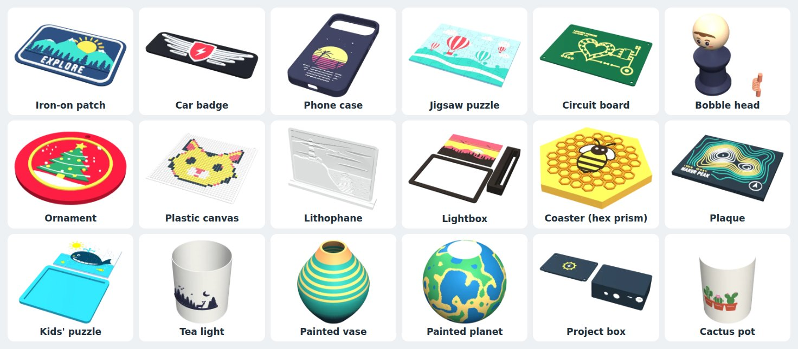

## 0.19

- **More ways to paint.** On the Paint tab's **Brush and fill** page:
  - **Pick colour** (key I) takes a colour from the model.
  - **Recolour** (key R) changes every part of one colour into another in one click.
  - **Box or lasso** (key A) paints everything inside a box or a loop you draw over the model: the side you see, or right through.
  - The brush **lights up what it will paint** before you press.
  - **Repeat round the middle** copies every stroke 2 to 12 times round the model, for vases, mandalas and wheels.
  - The **smart brush** stops at sharp edges, so painting a face does not spill round the corner.
- **Edges and hollows.** A new automatic colour: ridges and edges in one filament and hollows in another, for worn paint, stone and wood.
- **Pictures round a model.** The picture step can wrap a picture round the model like a label on a mug, or over it like a map on a globe.
- **Layers and colour changes.** A new Paint page counts the colour changes in the print, layer by layer, and estimates the filament they flush away and the time they take. Your printer sets the figures (a tool changer wastes far less than an AMS), and you can change them. A slider cuts the model open at any layer to show its colours. A painted figure can easily need hundreds of changes; now you see it before you print.
- **Patterns for colour.** Easy reading can put a pattern on each filament (stripes, lines, dots, hatching, checks) on the model and on the swatches, so filaments can be told apart without colour.

| Box select on the vase | Patterns on each filament | Colour changes, layer by layer |
| --- | --- | --- |
| 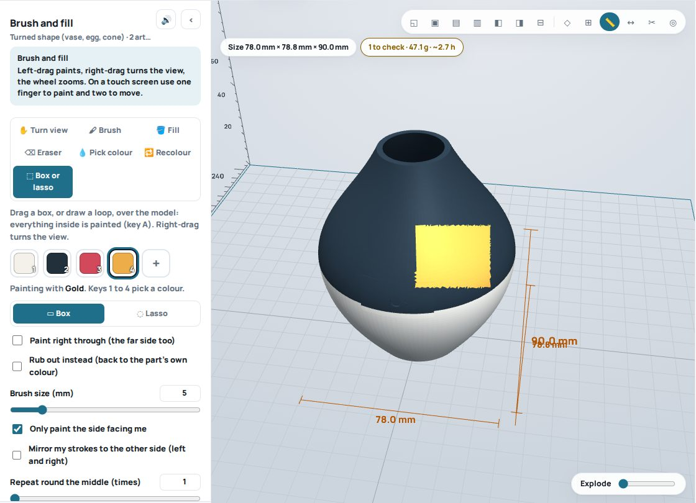 | 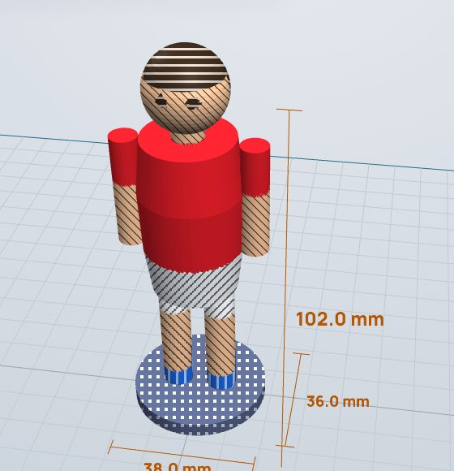 | 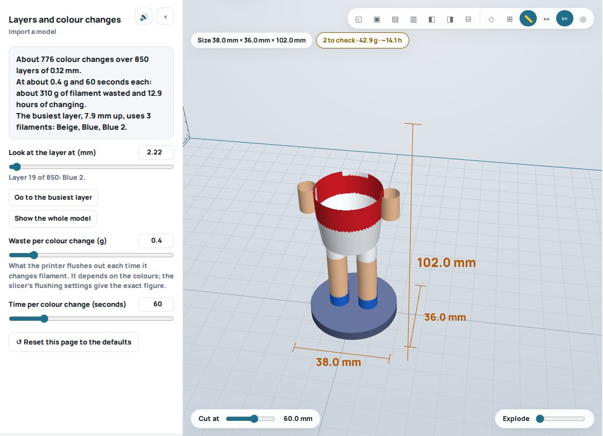 |

## 0.18.1

- **AI figure finder for busy backgrounds.** Colouring from a photo finds the figure by its colour against the background, which fails on a shelf, a desk or a patterned wall. On the photo card, **Busy background? Find the figure with AI** runs a small AI model (U²-Net, 4.6 MB) that marks the photo's main object, then lines the photo up from that. Nothing loads until you press it: then it downloads once (about 19 MB with its runtime, ONNX Runtime Web), every file is checked against its known fingerprint before it runs, and it works on your computer (your photos are not sent anywhere). Its result is saved with the project, so a reopened project colours the same without it. In tests with one front photo of a figure in front of a bookshelf, finding it by colour got 48 to 58% of the surface right; with the AI, 83 to 85% (87% on a plain background).
- Lining up picks the angle more steadily (a turn away from the side you chose has to fit clearly better), and a thin rim of background round a slightly misplaced outline no longer takes a filament of its own.

## 0.18

- **Colour a model from a photo.** Import a plain model (a figurine, a bust, a toy), open the **Paint** tab and drop a coloured photo of it on **From a photo of the model**. The app finds the figure in the photo, lines it up with the model's outline by itself (size, place, a slight turn, and the angle the photo was taken from), picks your filaments from the photo's colours (light and shade count as one colour; 2 to 8 colours, starting from the number your printer loads) and colours the model. The colour only goes where the photo really sees (the face does not come out on the back of the head); what no photo shows takes the nearest colour, and small specks are cleaned up while small details such as eyes stay. Add a photo from the back or a side for those parts (up to six photos). Fine-tune by dragging the photo, with the arrow buttons or keys, or by picking the side it was taken from; **Colours it reads** shows each colour in the filament it prints in. Then touch up with the brush and fill: they paint on top. The photos are saved in the project file.

| A plain figure coloured from a photo of its front and one of its back |
| --- |
| 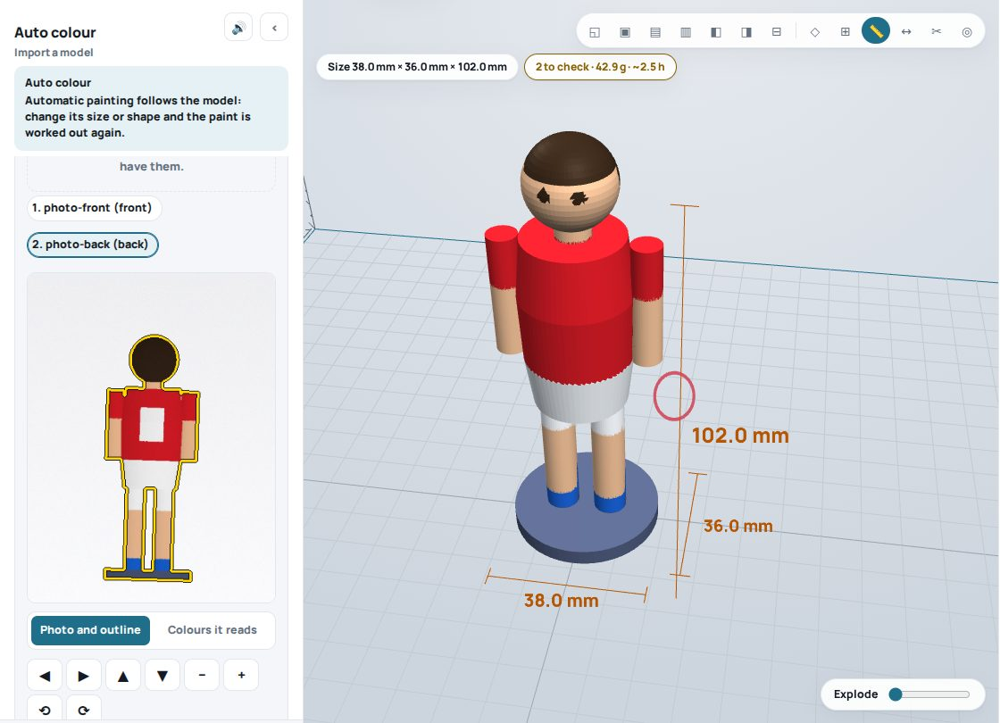 |

## 0.17.2

- **Every font is built in.** The 34 lettering fonts and the Easy reading font are inside `index.html`, so the page never downloads a font (and never talks to Google).
- **Saved projects keep imported models.** A project file now holds the model you imported and its paint. The autosave and share links still leave the model out and tell you which file to open again; opening the same file brings the paint back. Undo after opening a second model brings back the first.
- Fixed: a picture on a photo frame landed in the window and printed nothing (it now goes on the border); the arrow keys on the tab bar also moved your artwork; unticking "Show the paint" also left the paint out of the exported files without a word (it is now "Use the paint", with a warning); the phone case's Art tab showed placement controls that did nothing; damaged project files could crash a build.

## 0.17

- **Colour painter.** A new **Paint** tab colours any model, made here or imported, in up to eight filaments: **height bands** cut straight into the mesh, a **colour fade** between two filaments layer by layer, **stripes**, **tops and sides**, **separate pieces**, **smooth areas** split at sharp edges, a **picture projected** through the model, **random blobs**, or by hand with a **brush, fill and eraser** (mirror strokes for symmetrical models, keys 1 to 8 for colours). Painting follows the model when a setting changes. The paint goes into the 3mf files as slicer paint (`paint_color` for Bambu Studio and OrcaSlicer, `mmu_segmentation` for PrusaSlicer), so there is nothing to paint again in the slicer.
- **Import STL, OBJ and 3MF.** 3mf files from Bambu Studio, OrcaSlicer and PrusaSlicer keep their painting, the filament each part prints in, and the filament colours, so a model painted elsewhere can be repainted here.
- **Phone cases** for 75 phones, from the iPhone SE to the iPhone 18 Pro Max and Galaxy S26 Ultra (sizes from the makers' spec sheets): a snug TPU case or a bumper, a quick **fit test rim**, holes for the buttons and the port, a camera opening, a lip that prints without support, and a picture inlaid in the back in several colours.
- **39 printers**, grouped by maker, including the Bambu X2D, H2S, H2C and P2S, Prusa CORE One, Creality K2, Elegoo Centauri Carbon, Snapmaker U1 and more. Your printer is remembered for every new project.
- **Easy reading.** The **Aa** button makes text and buttons bigger (up to 175%), switches on high contrast, uses a font drawn for low vision (Atkinson Hyperlegible), keeps messages up longer and can read them aloud; 🔊 reads the open page aloud. Every slider has a **↺ default** button and every page a **Reset this page** button.
- **Project boxes:** round holes are round again (pointed tops are an option), and choosing a fan, display or board bigger than the box makes the box grow to fit instead of quietly leaving it out.
- **Pilot lights** wherever an LED goes: a printed **jewel lens** for a plain 3 or 5 mm LED (print it in a clear or coloured see-through filament), or holes sized for bought chrome-bezel LED holders and metal pilot lights from 8 to 22 mm.
- Fixed: reopening a saved project quietly changed four settings (charm size, picture size, artwork outline width and the plastic canvas pixel count).

| Colour fade and stripes on the Paint tab | Brush with mirrored strokes |
| --- | --- |
| 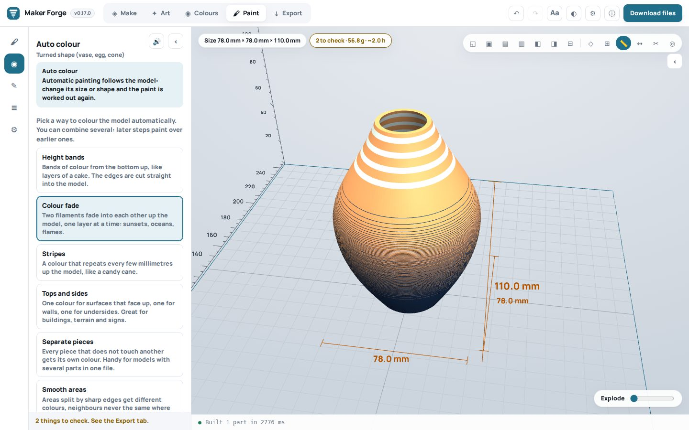 | 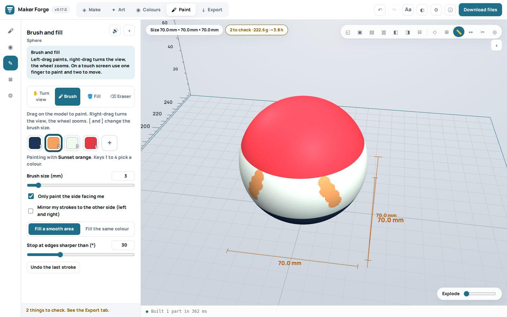 |
| **Phone case** for an iPhone 17 Pro | **A picture inlaid in the case's back** |
| 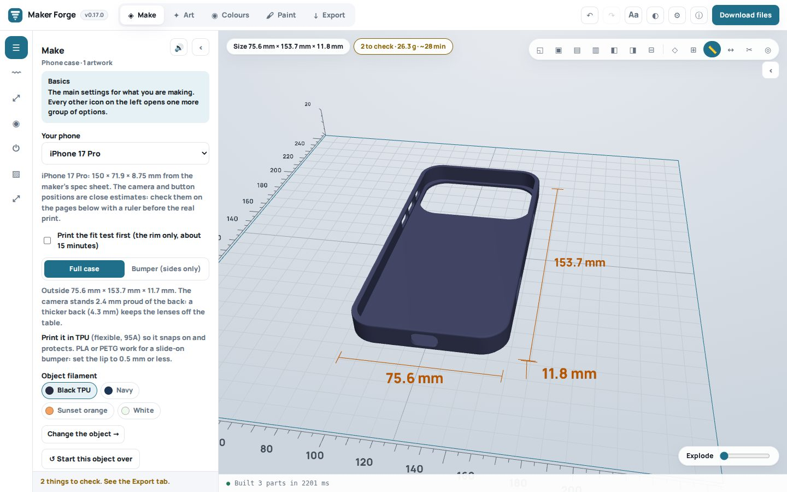 | 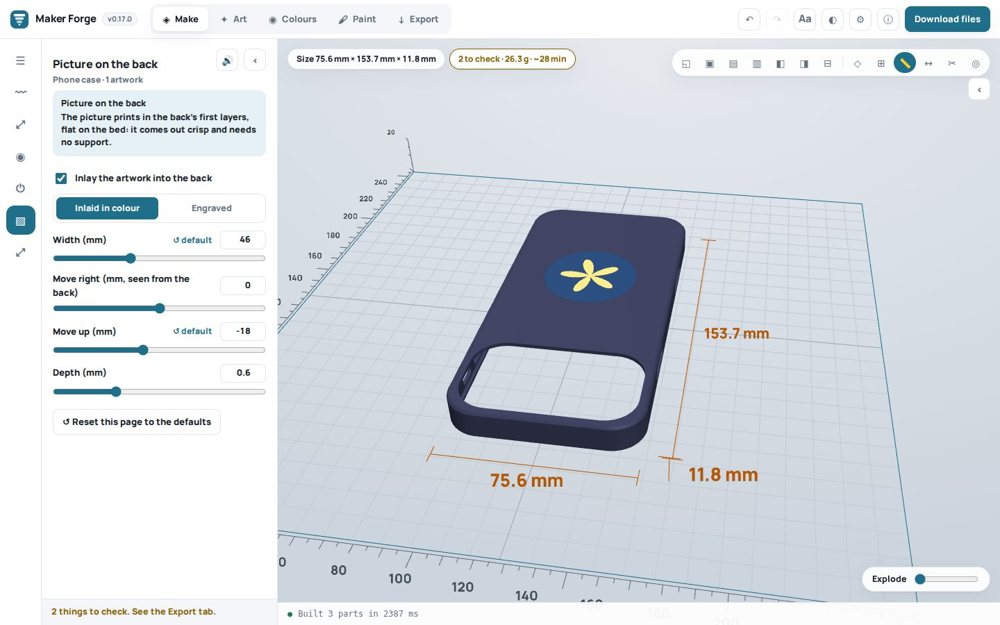 |
| **39 printers**, your Bambu X2D remembered | **Easy reading:** bigger text, high contrast, clear letters |
| 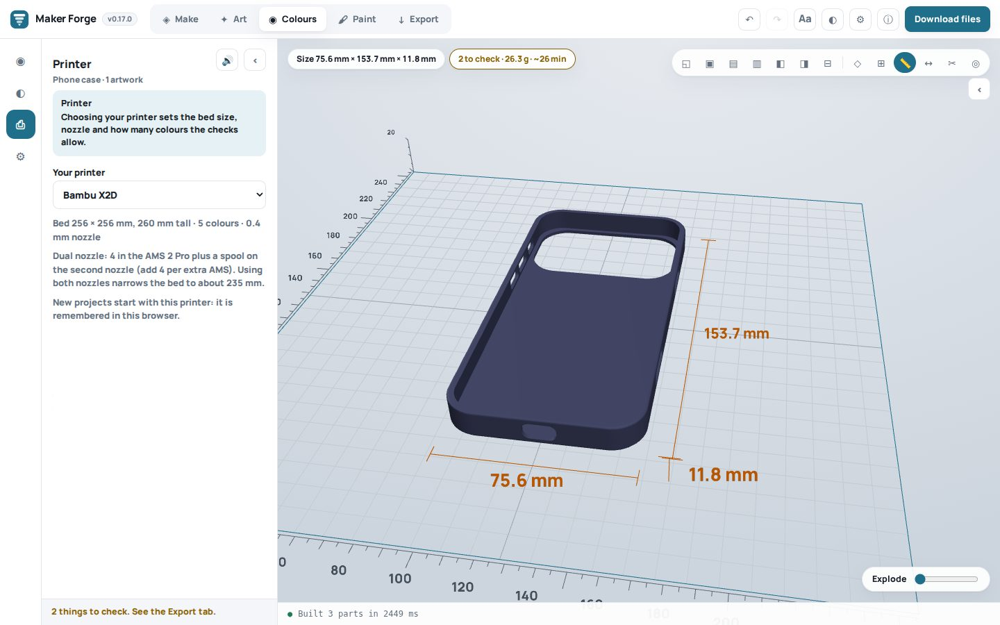 | 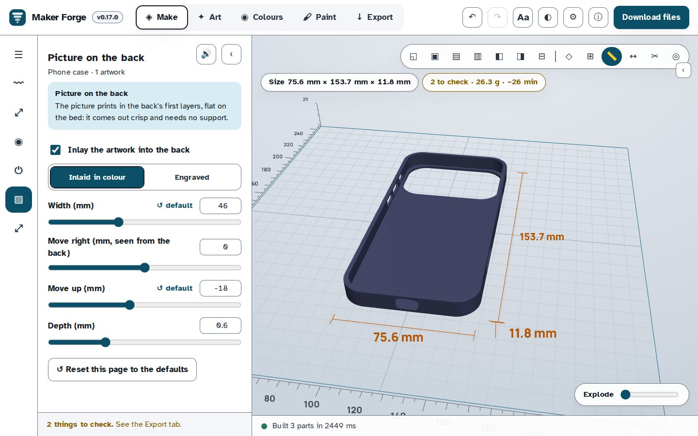 |
| **A PSU box with a 120 mm fan**: round grille, the box grew to fit | **Pilot lights** with printed jewel lenses |
| 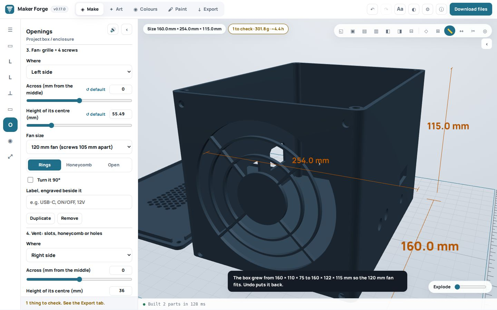 | 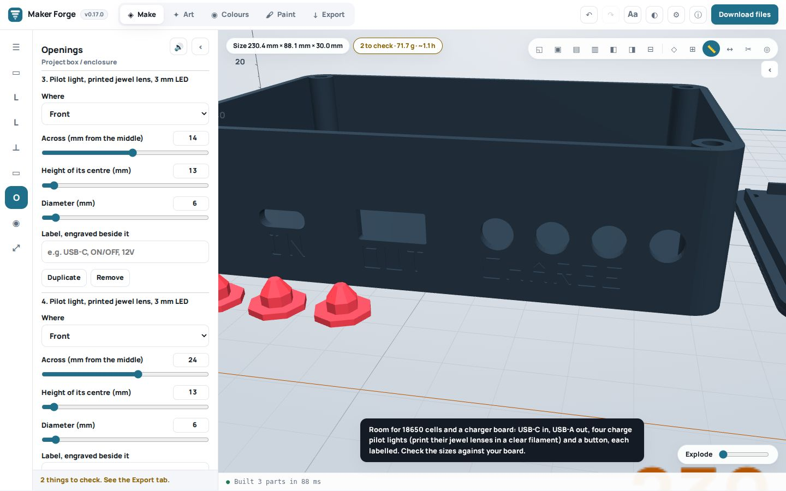 |

## 0.16

- **Project boxes grew up.** Engraved labels beside any opening ("USB-C", "ON/OFF", "12V"), magnet lids, a sliding lid on 45° rails, stick-on-foot recesses, ports that open to the top edge so the lid closes them, pointed tops for wide ports, your logo inlaid into the lid in its own colours, and a **fit test**: a small box with your walls, lid, screws and one of each opening, to try before the real print. The stock boxes now print without support.
- **Tracer:** SVG logos are drawn sharp and keep the size stated in the file; hairlines can be thickened to a printable width; multi-colour logos keep their colours on a body in your main filament; back plates get a hanging hole, a keychain loop or countersunk screw holes placed clear of the shape.
- **Name plates from a list:** paste names (or a spreadsheet column) and each gets its own plate, packed onto the bed.
- **Measure and look inside:** a measuring tape that snaps to corners, a section view that cuts the model at any height, and rulers in inches when you work in inches.
- **Share a link** that opens the same design for someone else (pictures stay on your machine).
- **Lithophane test strip:** steps from 0.6 to 3.2 mm, numbered, to choose thicknesses for your filament.
- **Checked in a real browser:** `npm run check:browser` opens the app in Chromium and walks every object and page. It found and fixed a name plate bug that only real fonts showed: plates with charms were clipped and printed with holes under the letters.
