# Maker Forge user manual

Maker Forge turns names, photos, logos and measurements into multi-colour parts you can 3D print. It runs in your web browser, on your own computer: nothing is uploaded, and there is no account to make.

This manual walks through the app from the first click to a finished print. The same text is inside the app: press **?** in the top bar.

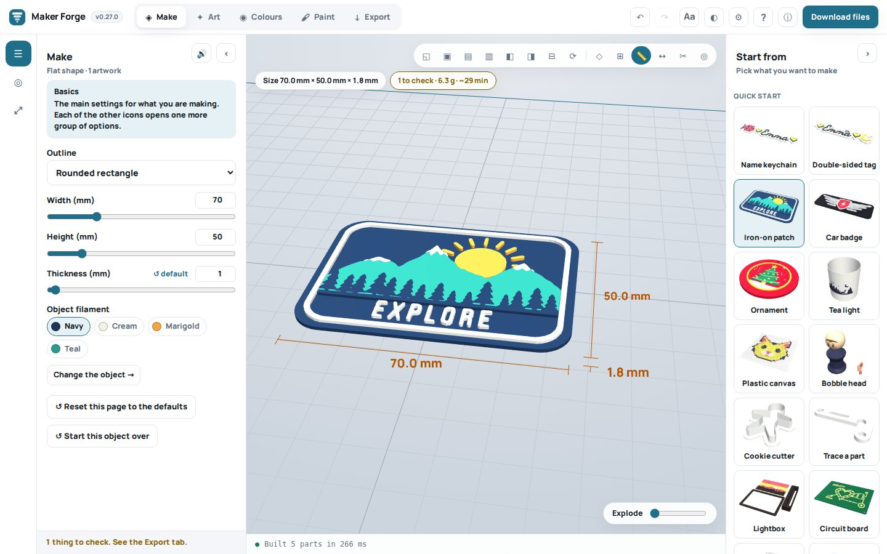

## Contents

1. [Getting started](#1-getting-started)
2. [Start from: quick starts, objects and examples](#2-start-from-quick-starts-objects-and-examples)
3. [Make: the object itself](#3-make-the-object-itself)
4. [Art: pictures and text](#4-art-pictures-and-text)
5. [Colours: your filaments and your printer](#5-colours-your-filaments-and-your-printer)
6. [Paint: colouring a whole model](#6-paint-colouring-a-whole-model)
7. [Export: checks and files](#7-export-checks-and-files)
8. [The 3D view](#8-the-3d-view)
9. [Saving, opening and sharing](#9-saving-opening-and-sharing)
10. [Easy reading](#10-easy-reading)
11. [Keyboard shortcuts](#11-keyboard-shortcuts)
12. [Printing tips](#12-printing-tips)
13. [When something goes wrong](#13-when-something-goes-wrong)
14. [Privacy](#14-privacy)

## 1. Getting started

Open `index.html` in a recent browser (Chrome, Edge, Firefox or Safari). That is the whole install. Keep the file anywhere you like; it works from your desktop or a USB stick. The first time, it needs the internet for a moment to fetch three small code libraries.

The screen has five areas:

- **The top bar.** The five tabs, **Make · Art · Colours · Paint · Export**, then Undo and Redo, **Aa** (Easy reading), light or dark, Settings, **?** (this manual), About, and **Download files**.
- **The page icons** down the left edge. Each tab's settings are split into pages; click an icon to open that page. The first icon of every tab holds the everyday settings.
- **The panel** next to them, with the settings of the open page. Every slider has a **↺** button that puts it back to where it started, and every page has **Reset this page** at the bottom. The **🔊** button reads the page aloud.
- **The 3D view** in the middle: the model as it will print, sitting on your printer's bed. The line at the top says its size and whether it is ready to print.
- **Start from** on the right: every quick start and every object, each with a picture of what it makes.

The line along the bottom says what the app is doing. Click it to see a log of everything that happened.

### On a phone or tablet

Maker Forge works on phones and tablets too. On a narrower screen, or with bigger text from **Aa**, the layout changes to fit:

- **Start from** becomes a button in the top bar. It opens the quick starts and objects over the page, and closes once you have chosen one (or with **✕**).
- The less-used buttons in the top bar (Redo, **Aa**, light or dark, Settings, the manual and About) move into the **⋯** menu.
- The seven view buttons fold into one, **◱▾**.
- On a phone held upright, the model sits at the top and the settings scroll below it. The page icons run in a row between the two. **‹** hides the settings so the model gets the whole screen; tap any page icon to bring them back. Turn the phone on its side and the settings sit beside the model instead.
- In the 3D view, drag with one finger to turn the model and use two fingers to zoom and move it. While you paint, one finger on the model paints and one finger beside it turns the model; two fingers zoom and move it, and **✋ Move** (bottom left of the view) frees the view until you press it again.

A computer is still the easiest place for detailed work, but every setting, and **Download files**, is within reach on a phone.

### Your first print in five steps

1. Click a button under **Start from**, for example **Iron-on patch**. A finished example appears.
2. On the **Art** tab, add your own picture. It takes the example's place, with the same settings.
3. On the **Colours** tab, choose your printer and set the filament colours to the spools you have loaded.
4. On the **Export** tab, read **Before you print**. Fix anything red.
5. Press **Download files**. Open the 3mf file from the zip in your slicer and print.

## 2. Start from: quick starts, objects and examples

The **Start from** sidebar has two kinds of button.

- **Quick starts** set everything up for one product: the object, its size, the filaments that suit it and a tip on how to print it. *Car badge*, for example, makes a 95 × 32 mm plate and reminds you that PLA softens in a hot car.
- **Objects** are the makers behind the quick starts: a flat shape, a name plate, a jigsaw, a lithophane and so on. Choosing one keeps your pictures and colours and changes only the object.

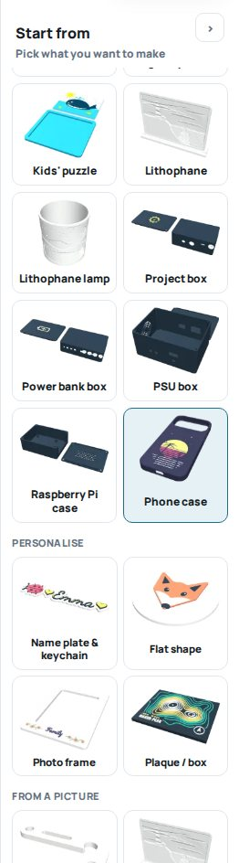

### The examples

While you have no pictures of your own, every button opens with a finished example, so you can see what it makes before you start: a mountain patch, a winged car badge, a Christmas bauble, a pixel-art cat, a circuit board with an LED heart, a hot-air balloon jigsaw, a lighthouse lithophane, a phone case with a retro sunset, a black and gold business card, and more. The example's picture is marked **Example** on the Art tab.

- **Add your own picture** and it takes the example's place, with all the same settings. On a phone case or a project box, your picture goes onto the back or the lid, just as the example did.
- The example also picks **filaments** that match its picture, but only while you have not changed them yourself. Undo (Ctrl+Z) brings your old colours back.
- The vase and the planet show off the **Paint** tab instead: their colours are painted on, and you can change or clear them there.
- A phone case, the project boxes and a business card carry their picture on the side that prints on the bed, so they open **turned over** to show it. A phone case also turns over by itself whenever you put a picture in its back. The **⟳** button above the model turns it back, and the case stays that way until you open something else.

All the example pictures were drawn for Maker Forge and are free to use, like the rest of the app.

### What each quick start makes

| Quick start | What it makes | What you add |
| --- | --- | --- |
| Name keychain | A name with a border, a ring hole and charms | Type a name; optionally a small picture beside it |
| Business card | A card the size of a bank card, with a QR code and, if you like, an NFC tag inside | Your name and details; optionally a logo |
| Double-sided tag | A tag that reads from both sides | A name |
| Iron-on patch | A thin, flexible badge to sew or iron on | A logo or drawing |
| Car badge | A long badge for a car or a bike | A logo |
| Ornament | A round bauble with a hanging hole | A picture |
| Tea light | A lantern to put over an LED tea light | A silhouette, or a photo as a glowing relief |
| Plastic canvas | A square-by-square mosaic, like cross-stitch | A small picture or pixel art |
| Bobble head | A head on a spring neck and a body | A face |
| Cookie cutter | A cutter that follows a picture's outline | A silhouette |
| Trace a part | A copy of a flat part from a photo of it | A photo of the part on white paper |
| Lightbox | A backlit picture panel with a frame and stand | A photo or drawing |
| Circuit board | A decorative board with raised copper | A schematic or PCB screenshot |
| Photo frame | A frame with a picture on its border | A small picture or words |
| Frame for a photo | A frame for a 10 × 15 cm photo, with a back panel, a stand and keyholes | Your photo, printed at 10 × 15 cm |
| Jigsaw puzzle | A puzzle that prints in one go | A picture |
| Kids' puzzle | Twelve chunky pieces in a tray | A bold picture |
| Lithophane | A picture that appears when light shines through | A photo |
| Lithophane lamp | A lithophane cylinder for an LED tea light | A wide photo |
| Project box | An electronics box with a screwed lid | Optionally a logo for the lid |
| Power bank box | A box for 18650 cells and a charger | Optionally a logo |
| PSU box | A box for a mains power supply module | Nothing |
| Raspberry Pi case | A case with standoffs for a Pi | Nothing |
| Phone case | A TPU case for one of 75 phones | Optionally a picture for the back |
| Gear pair | Two spur gears that mesh, with shaft holes | The number of teeth and the tooth size |
| Bolt and nut | A threaded bolt and a nut that screws onto it | A metric size, or your own |
| Replacement knob | A knob for a D-shaped or round shaft | The shaft's size, from calipers |
| Light-up letters | Hollow letters for an LED strip, with faces that drop in | Your text |
| Neon sign | A channel for LED neon strip along each letter, on a board | Your text (capitals and digits) |
| House number | Solid numbers with keyholes in their backs | Your number |
| Photo relief | A plaque whose surface rises with a photo, from AI depth | A photo of a face, a pet or a place |

## 3. Make: the object itself

The **Make** tab holds the settings of the object you chose: its size, shape, thickness, holes and everything particular to it. The first page, **Basics**, has the ones most people need. The other pages hold the rest; a short line at the top of each page says what it is for.

At the bottom of the Basics page:

- **Object filament** says which of your filaments the object prints in.
- **Change the object** opens the Start from sidebar.
- **Size and mirror** scales the whole model, or mirrors it. Paint stays on the same spots when you do.

An imported model has its own **Scale (%)** on the Make tab. Changing it is instant, even on a big model: the paint and any pictures or text on it grow and shrink with it.

**Cut it flat** (an imported model's Make tab) cuts off the bottom of the model so it stands on a flat face: handy for a bust, or a figure on round feet. Set how much as a share of the model's height; the line under the slider says how many millimetres that is at its size. Paint and pictures stay where they were on the model. The first time, the app downloads its cutting tool (0.6 MB, checked before it runs).

Some objects in brief:

- **Name plate and keychain.** 34 lettering fonts, charms (♥ ★ and any emoji) on either side, a picture beside the name, raised or engraved letters, a top layer in a second colour, and a mirrored name set flush into the back for double-sided tags (it prints in the first layers in its own filament, so the tag lies flat). **A keychain for every name** on the Export tab makes one per name from a list.
  - **Second line**: a surname (or anything) under the name, smaller. Set its size as a share of the name's, and the gap between the lines. In **A list of names**, write `Emma | Svensson` to give that name a second line.
  - **Credit on the back**: a short line of text on the back, such as your website or shop, for keychains you give away. It is mirrored, so it reads when the tag is turned over. **In a colour, flush** prints it in the first layers in a second filament, face down on the bed; **Engraved** cuts it into the bottom. It shrinks to fit inside the plate's edge and clear of the ring hole, and moves aside from the middle of the name if it fits better there; the slider says when it was made smaller. A double-sided tag has its name on the back, so it takes no credit.
  - **Something on the back too** (a double-sided tag): the name mirrored, or **your own text**, such as "If found, call…" or a second name, in the name's font. Either is set flush into the back in its own filament, so the tag lies flat. Your own text is as big as the name or smaller, until it fits 1.2 mm inside the edge.
  - **Magnet**: a round pocket in the back for a 5 to 12 mm neodymium magnet, so the name sticks to a fridge, a whiteboard or a toolbox. The pocket opens on the bottom, 0.3 mm wider and 0.2 mm deeper than the magnet: press it in after printing with a drop of glue. One or two magnets, placed where the plate is deepest, clear of the edge, the ring hole and any letters on the back. The panel says when the plate is too thin or too small for the one you picked.
- **Photo frame.** A frame of your size with a picture on its border, or a frame **for a photo**: pick the photo's size (wallet, 9 × 13, 10 × 15, 13 × 18 cm, A6, A5, square or your own), upright or sideways.
  - The frame is the photo plus the width you choose round it. The window shows the photo less the overlap you set (4 mm hides its edges).
  - It prints face up. The photo and a clear sheet (1 mm acrylic or 0.5 mm PET, cut to the photo's size, or none) go in from the back, then the **back panel** presses in after them. The notch at the bottom of the pocket lets you lift the panel out with a fingernail.
  - The window's edge is bevelled at 45°, like a mount board, which is also why nothing needs support.
  - **A stand**: a leg that plugs into a socket on the back panel, printed in the frame's window. **Keyholes**: two raised blocks on the panel to hang it on two screws.
  - A frame without a photo, a plaque and a sign on a board can each have **a stand to hold it up**: a low base with a slot their bottom edge slides into, leaning back 10°.

  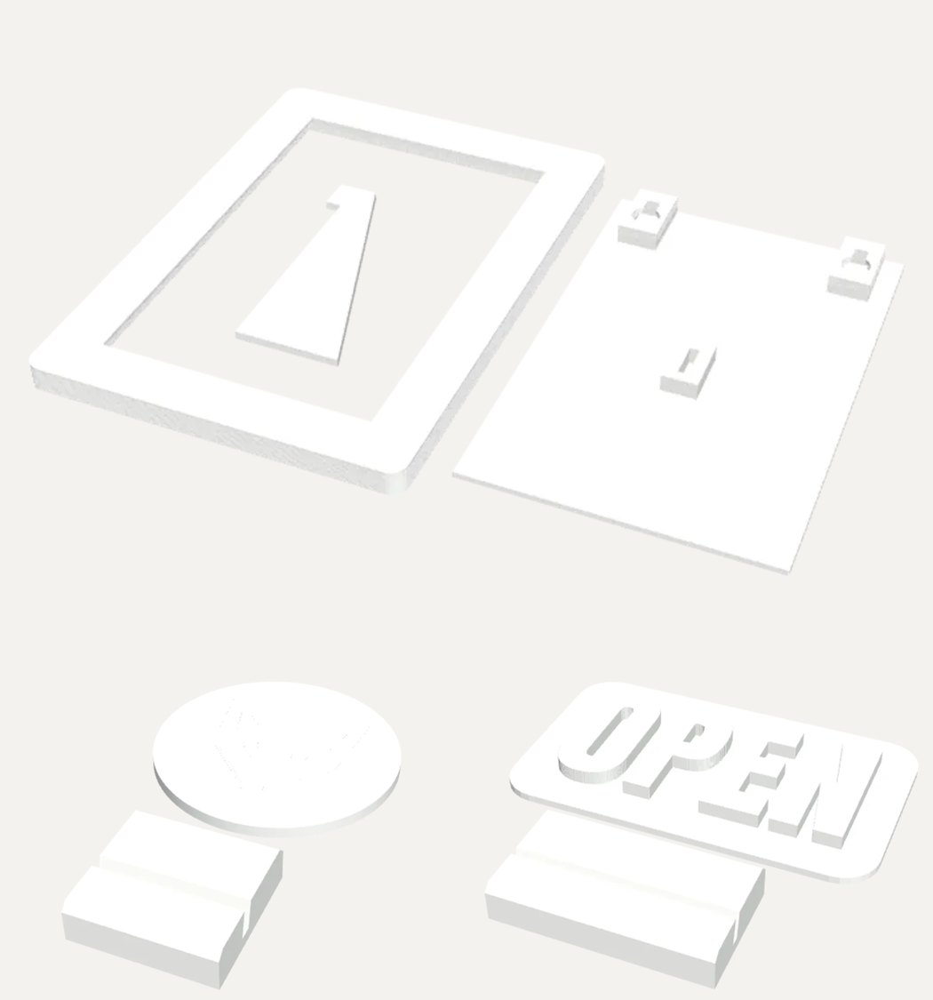
- **Photo to 3D tracer.** Photograph a flat part on plain paper, shot from straight above. Give one real measurement, or let the sheet of paper be the ruler. Round holes become true circles. The outline also downloads as SVG and DXF.
  - **Edges** (step 5): a **chamfered** or **rounded** top edge, nicer to hold; a **bottom chamfer** (0.3–0.5 mm) so the first layer's squish doesn't make a fitted part too big; and **Countersink the round holes**, so flat screw heads sit flush (a screw's clearance hole, M2 to M4, takes that screw's head; any other round hole widens to twice its size). For the shape on its own, in one colour.
- **Lithophane.** Flat, curved or a cylinder, with a rectangle, arch, oval or heart outline. The **test strip** prints steps from 0.6 to 3.2 mm, so you can choose thicknesses for your filament.
- **Jigsaw puzzle.** Choose the number of pieces, the style of the knobs and the gap. **Shuffle** draws a new cut. A frame or a tray can print with it. A strip of a picture's colour thinner than the nozzle takes the colour beside it, so it doesn't print as a sliver.
- **Project box.** Openings for USB, buttons, switches, fans, displays and pilot lights, each with an optional engraved label. Screwed, magnet or sliding lids. **Fit test** prints a small box with one of each opening, to try before the real thing.
  - **Describe your project** (new in 0.43) fills the box in from a few words: type what goes in it ("ESP32, a 4-channel relay, LM2596 buck converter, OLED, two buttons, 60 mm fan, cable gland") and press **Fill it in from the words**. Each part is matched to a board, module or opening; the boards are arranged in the smallest box that fits your bed, the box grows for its openings, and each opening goes on a sensible face (screens in the lid, where they print without support; fans and vents on a side; sockets and glands at the back; the rest on the front), moving to the next face when one is full. It says what it found and what it didn't recognise. The ready-made buttons (**ESP32 sensor box**, **Relay controller**, **Fan-cooled box**, **Battery LED controller**, **Bench power supply**) fill the words in for you. With **AI help** set up (see [AI help](#ai-help)), **Plan it with AI** also picks faces, levels and a lid icon. It starts the box's boards and openings again; Undo puts them back.

    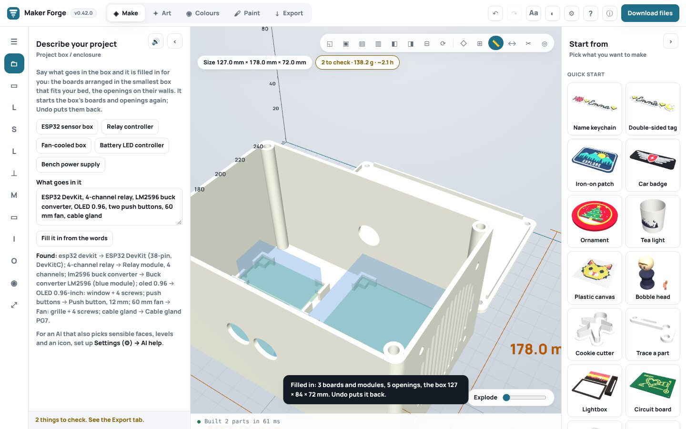
  - **Add an opening** lists about 150 parts in groups: ports and power, buttons and switches, lights, screens and meters, sensors and cameras, sound, fans and vents, and mounting and your own sizes. **Type in the search box above it** to find one: every word you type must match its name, its group or a word it's known by ("esp8266", "neopixel", "gland m20"). Enter adds the first match. Among them:
    - an ESP32-CAM or XIAO ESP32-S3 Sense camera lens, and a Raspberry Pi camera with its four screws;
    - motion sensors: the HC-SR501 dome with its two screws, and the small AM312 / HC-SR505;
    - the HC-SR04 distance sensor's two eyes;
    - a USB-C charging board's port (TP4056 and IP5306 type), a DC jack on a board, XT60, a 3.5 mm audio jack and an SMA antenna socket;
    - slide switches, rotary encoders, key switches, a thumb joystick, big arcade buttons and M12 toggles;
    - small OLEDs, TFT screens, an 8×8 LED matrix, 4-digit displays and a volt and amp meter;
    - light, IR, temperature and microphone holes, and a speaker or buzzer grille of small round holes;
    - (new in 0.39) USB-B, mini-USB, micro- and mini-HDMI, stacked USB-A, full-size SD, keystone jacks, RJ11, D-sub 9, 15 and 25 and XLR with their screws, 6.35 mm jacks, RCA, BNC, F and N antenna sockets, GX12/GX16 and M8/M12 connectors, fuse holders and an IEC inlet with fuse and switch;
    - 19 and 25 mm buttons, a 24 mm arcade button, key and rotary switches, a guitar-pedal footswitch, slide-potentiometer slots, a trimmer screwdriver hole and a reset pinhole;
    - WS2812 LED rings (12, 16 and 24 LEDs, a window in four arcs so the middle stays joined), an LED stick, an LED strip window, light pipes and an 8×32 LED matrix;
    - e-paper (1.54 to 4.2-inch), small ST7789 and ILI9341 TFTs, a round GC9A01, a 3.5-inch TFT, a 128×64 LCD, a 5-inch HDMI screen and the Raspberry Pi 7-inch touch screen;
    - gas, waterproof distance, laser distance, light and gesture sensors, a MEMS microphone hole and a sensor vent; speakers from 40 to 77 mm and a piezo disc;
    - PG and metric cable glands, a grommet and zip-tie slots.
  - Sizes are for typical parts, and the clearance on the Print and colours page is added on top. Modules differ between makers, so measure yours with calipers; the screens marked "check yours" vary most. A microwave radar sensor (RCWL-0516) needs no hole: it sees through plastic.
  - **Board mounts** holds the electronics (new in 0.39: over 60 boards and modules, with a search like the openings):
    - Arduino (Uno, Leonardo, Mega, Due, Nano, Micro, Pro Mini, MKR), Raspberry Pi (5/4/3, 3 A+, Zero, Pico), ESP32 and ESP8266 boards (DevKits, S3, C3 SuperMini, ESP32-CAM, XIAO, NodeMCU, D1 mini, T-Display), Teensy, STM32 pills, Feather, ItsyBitsy and micro:bit;
    - modules: buck and boost converters, TP4056 and power-bank boards, battery protection boards, Mean Well LRS power supplies, relay modules (1 to 8 channels), L298N, TB6612, stepper drivers, MOSFET and servo drivers, HX711, RTC, SD card, RFID and NFC readers, GPS, MP3 player, amplifiers, sensors, radios; and battery holders (18650, AA, 9 V, a LiPo pouch).
    - A board with holes sits on **standoffs** under them. One without holes (most small modules, and boards whose holes differ between makers) sits in a **cradle**: a seat under each corner and a low L-shaped fence round it, 0.3 mm clear, so it drops in. **By its edges** uses a cradle for a board with holes too. Those marked "check yours" vary between makers: measure yours, and use **My own board** if it differs.
    - **Add another board or module** puts more in the same box (up to 12), each with its own position, height and standoffs or cradle. Two that take the same place are named.
    - **Add this board's ports** (Arduino Uno, Leonardo, Mega, Raspberry Pi 5/4/3, 3 A+, Zero, Pico, Nano, ESP32 and ESP8266 boards, XIAO, Teensy, STM32, Feather, TP4056) slides the board against the walls its ports face and adds an opening for each port, at the height the board puts it. Check them against your board: makers move ports about.
    - **Arrange it for me** (new in 0.42) lays them all out for you. **Arrange it for me (smallest box)** packs every board and module on its floor or level, 3 mm apart and clear of the corner screw posts, with the main board against the walls its ports face (its port openings move with it), then makes the box as small as that allows while still fitting your printer's bed. **Arrange in this box** keeps the box's size, or tells you it is too small. Undo puts everything back.
  - **Inside: levels and dividers** (new in 0.40):
    - **Show the parts inside** draws each board, the room its parts take (a relay's cube, a heatsink, a USB socket) and its ports see-through in the box. They aren't printed. The box warns when parts reach the lid or the level above, and names a port with no opening in front of it.
    - **Add a level** puts in a second floor (up to three): a shelf at the height you set, printed flat as its own plate, on four posts it screws to (M3 self-tapping) or on ledges along the side walls. It can have a slot for cables and air slots. Put extra boards on it with **On** in Board mounts.
    - **Add a divider** splits the box (up to four), across or front to back. The plate slides into grooves on the walls and the floor and prints flat. It can hold a fan (40 to 140 mm) and have a notch for cables. It stands up to the lid, or under the lowest level.
    - **Zip-tie anchors** are little bridges on the floor for tying cables down, along the back, the sides or all round.
    - When it all doesn't fit one bed, each part goes on a plate of its own.
  - **Printing without support** (new in 0.41): a port opening in a wall gets a pointed top by itself when its top edge would be a bridge longer than your printer's bridge limit (set on the Printer page): **Top: auto**, **Flat** or **Pointed** on each opening. Fan grilles in walls default to **Slots**, upright slots with pointed tops; **Honeycomb** in a wall uses flat-topped cells; vent slots have pointed tops. All of them print without support.
  - **Mounting** hangs the box up:
    - **Screw ears:** two or four tabs at floor level, each with a screw hole and a 45° fin each side.
    - **DIN rail:** a clip for 35 mm rail, as in a fuse box. It prints flat beside the box; screw it under the floor from inside with two M3 × 8 mm screws, and slide it onto the rail from one end.
    - **Strap loops:** loops on the back for a zip tie or a hook-and-loop strap, running across (round a post or a bike frame) or up (round a handlebar).
    - **Hanging tabs:** one or two tapered tabs on the back rising above the lid, like a picture-hanging plate, each with an upright slot for a screw or nail. The slot is above the lid, so you can reach the screw.
    - **Hooks for IKEA SKÅDIS:** flat hooks 40 mm apart (or 80, 120…). Tip the box, push the hooks through two slots in a row, and let it down.
    - **Pegs for pegboard:** for boards with 1/4-inch holes on a 1-inch grid, up to 6 mm thick. They go in the same way.
    - None of them need supports. To hang the box on screws through its back wall, add a **Wall-mount keyhole** opening on the back instead.
  - **Split into parts**: a box bigger than your printer's bed is made in parts that screw together, each small enough for the bed. It is cut across its longer side. Inside each join both parts have a flange: the first part's has holes for heat inserts (or pilot holes, with **Self-tapping** screws), the next part's has clearance holes, and screws go through from inside. The lid is cut at the same places, and with a screwed or magnet lid the flanges also take two more lid screws (or magnets) each side of every join, so each part of the lid holds down on its own.
  - **When it's bigger than the bed** (the usual choice) splits only when it has to, into as few parts as fit. **Always** splits it into the number of parts you set (2 to 8), even if it fits. **Never** keeps it in one piece. **Screws for the joins** sets the screw size (M3 unless you change it).
  - The joins move to keep clear of openings, labels, posts, standoffs, feet, the board and the mounts; ears or loops that stick out count in each part's size. When one can't (a vent as long as the box, say), the app says which opening is in the way. A box with a sliding lid isn't split.
  - The page says how the parts go together, how many inserts and screws to buy and their length, and what prints on each plate. **⊞** above the model lays the parts out on their plates; the download has a file for each plate (see Export).
  - The flanges are set inside the walls, so the parts are exactly as long as the box between the joins. Press the inserts in before you put the parts together.
- **Phone case.** Pick your phone; the sizes come from the makers' spec sheets. Print the **fit test rim** first. Print the case in TPU.
  - **A picture in the back** (Make tab, **Picture on the back**) is set flush into the back's first layers, in your loaded filaments. It works best with a logo, a drawing or text in a few flat colours. A photo is reduced to flat areas of your filaments and can look rough; the app says so. **Colours → Match to artwork** (or the button under the message on the Art tab) sets your other filaments to the picture's colours, keeping the case's own, and **Art → Cut out the subject with AI** takes a photo's background away.
  - The Art tab shows the picture in the colours it prints in. Click a colour there to leave it out.
  - Gaps between two colours narrower than the nozzle are filled with the colour beside them, so no strip of case too thin to print is left.
  - The check under **Before you print** may say the case needs a little support: that is the top edge of the button and port openings. Slicers bridge them; leave supports off, or they fill the openings.

### Business cards

A card the size of a bank card (85.6 × 54 mm), or a European, US, Japanese, Australian, square or mini card, a bag tag or a size of your own, lying or upright. It prints flat in one go.

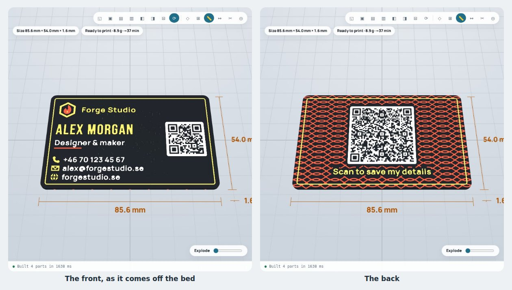

- **Name and details.** Your name, title, a tagline under the title (a little smaller, on the front), company and up to 8 lines of details. Each line gets a small icon from what it looks like: a phone number, an email address, a web address, an @handle or an address. Pick a font for the name and one for the rest, their sizes (the height of a capital), capitals, letter spacing, the space between lines and how they line up. A short or full line can go under the name.
- **Layouts.** Words on the left and the code on the right, the other way round, centred, a band down the side holding the logo and the code, or just the name and title (the rest goes on the back). On an upright card the code goes at the foot. Everything can be nudged.
- **QR code.** On the front, the back or both sides, each with its own job: a web address, a contact card (made from your details, so a phone saves you in its contacts with one tap), a phone call, a text message, an email, a Wi-Fi network or any text. Square, rounded or dotted squares, square, rounded or round corner eyes, and your initials in the middle if you like. A light patch goes behind a code on a dark card. The page says how big each square comes out: keep them at 1.5 nozzle widths or more (0.6 mm for a 0.4 mm nozzle). A contact card holds a lot, so it needs a bigger code than a link. Test the code with your phone's camera on the model before printing.
- **Logo.** The picture from the Art tab, in its own colours or in one, or your initials in a circle, hexagon, diamond, square or shield.
- **Flashy extras.** A border (a line, a double line, a thick frame, corners, dashes or dots), a band of colour along a side with a straight, slanted, wavy or curved edge, and 15 patterns: stripes, pinstripes, chevrons, a grid, dots, halftone dots, honeycomb, triangles, waves, banknote guilloche, contour lines, a sunburst, carbon weave, circuit traces and confetti. A pattern can cover a face or part of it, fade across it, and keeps clear of the words and the code.
- **How it prints** (**Printing the card**). Face down, the front prints flush in the card's first layers, as smooth as your bed (a textured plate gives it its texture). The face on top can be flush, raised or engraved: flush keeps the card flat both sides, so it slides into a wallet. Light colours over a dark card need 0.6 mm or more to look solid. With a one-filament printer, **Everything raised in one colour** needs a single swap.
- **NFC tag.** A pocket inside the card for an NFC sticker (20, 25, 30 or 38 mm), a coin tag, or a tag of your own size: in the middle, behind the logo or the code, or where you put it, with a small mark on the card to tap. Write the tag first with a free app such as NFC Tools. The card is made thicker if the tag needs room. The printer must pause once: **Before you print**, the Export tab and **nfc-tag.txt** in the download say before which layer. Add a pause there in your slicer, press the tag in when it stops (a sticker without its backing paper), and carry on: the next layer seals it in.
- **A keyring or lanyard hole**, up to 12 **copies** on the bed, and **a card for each name** in a list (one a line, `Name | Title`).

### Signs

Under **Personalise**: house numbers, shop signs and room names, lit or not. Type up to four lines of text, pick a font and the letter height. It prints lying on its back.

- **Solid letters.** Thick letters to screw or hang on a wall. On their own, each has a **keyhole** in its back (a screw in the wall, its head 5 mm out, and the letter hangs on it; letters 12 mm thick or more), or **holes for pins** (8 mm or more).
- **Lit letters.** Hollow letters for an LED strip stuck round the inside of the walls. Each has a hole in its back for the wires and a keyhole to hang it from (the screw's head goes into the hollow and slides up). The **faces** print flat beside them, 1 mm thick in white or natural (the **Face filament**), and drop onto a ledge just inside the top. The ledge slopes at 45°, so nothing needs supports. The panel says how much LED strip you need.
- **Neon style.** A groove for silicone LED neon strip (6 or 8 mm wide) along each letter, between two walls, on a board. It uses a single-line font, so capitals, digits and - + / . only. Holes at the ends of each stroke let the strip pass to the back; the panel works out the strip's length.
- **Backing.** Separate letters, letters **joined by a rail**, **on a board**, or on a **board round the text** that follows the letters. A board gets screw holes at its top corners (lit letters on a board still hang from inside each letter).

A sign wider than your bed says so: make the letters smaller, or print separate letters.

### A 3D relief from a photo

Under **From a picture**: a plaque, medallion, arch or heart whose surface rises with a photo. It prints face up, with no supports; fine layers (0.12 mm) show the detail best.

- **AI depth** (the default). Press **Work out the depth with AI**: the app downloads a depth model the first time (27 MB, checked before it runs) and works out how near each part of the photo is, in about ten seconds. Nearer parts stand higher, so a face, a pet or a landscape becomes a real relief, not one where a dark jumper is a hole. The depth is kept with the picture, so a saved project opens without running it again. Until you press the button, the relief rises with brightness.
- **Brightness** instead: light parts stand higher (**Invert** for dark).
- **Carve it (tame the jumps)** works as a carver does: each part keeps its own shape (a head stays round) and the big jumps between near and far, such as a figure in front of a wall, are made small. At 0 the depth is used as it is, and a figure stands on a flat-topped step. **Use the whole height for the subject** finds where the background ends, keeps it at the base and spreads the subject's depth over the whole relief.
- **Relief height** is how far the nearest part stands above the **Base**. **Keep the background flat** leaves the farthest share at the base, **Contrast** shapes the curve, **Smoothing** softens it and **Detail** sets how fine the surface is.
- A **border** (at a share of the relief's height) and a **hole to hang it**.
- **The photo's colours**: the relief's face is painted with the loaded filaments nearest the photo, so a multi-colour printer prints the photo on its own relief. The border, sides and back stay in the relief's own filament; turn colours off on the Art tab to leave them out.
- **A stand to put it on a desk**: a low base whose slot takes the relief's bottom edge.

### The model doctor

An imported model's Make tab has a **Model doctor** page. It says how many triangles the model has, how many separate shells, and whether it has holes, triangles the wrong way round, edges shared by more than two triangles, or flat and doubled triangles: the usual faults of a model from a download, a scanner or an AI maker.

- **Repair it** joins points that should meet, removes flat and doubled triangles, turns every triangle to face outwards and fills the holes. A model that comes back a closed solid prints, cuts and paints properly.
- **Simplify** (half, a quarter or a tenth of the triangles) keeps the shape with fewer triangles. A model straight from a scanner or an AI maker is often far finer than a print can show, and a smaller one makes everything faster.
- Both keep the model's paint and own colours (a triangle filling a hole takes none). **Back to the original**, or Undo, brings the old one back.

### Mechanisms and fix-it parts

Parts that move or fit something you already have. Both are under **Functional** in the Start from sidebar. Measure with calipers and type the sizes; everything prints in the way that needs no supports.

**The fit gap** (the **Fit** page of both) is the play left between parts that move, slide or screw together: a nut on a bolt, a pin in its knuckle, a knob on its shaft. Printers differ, so print the **fit test** once: a plate of holes from tight to loose, each with its gap printed beside it, and a peg. The first hole the peg slides through without forcing is your fit gap. Set it, and every mechanism and fix-it part uses it. A raised dot on the plate marks the hole for the gap now set.

**Mechanisms**

- **Gears (a pair).** Spur gears with true involute teeth. Set the teeth on each and the tooth size (the module: both gears must have the same one to mesh), the thickness, a shaft hole (round, D-shaped or a hexagon, with the fit gap added) and a hub. The panel says how far apart to put the shafts and the ratio. **Meshed, to check** shows them turning together; print them **Apart**. Gears under 13 teeth turn less smoothly.
- **Bolt and nut.** ISO metric threads from M3 to M30, or your own diameter and pitch, with a hex head, a knob head or none (a threaded rod), and a hex nut with the fit gap of play. Both print standing. Threads under 6 mm come out rough with a 0.4 mm nozzle.
- **Print-in-place hinge.** Two leaves joined by knuckles round a pin, printed already assembled: break it free with a gentle twist. Set the length, the leaves, the number of knuckles, the knuckle and pin sizes and screw holes. The holes in the knuckles have pointed tops so they print without supports. The print check marks the pin's underside: it prints over a gap as narrow as the fit gap, which a print-in-place hinge needs. Below 0.25 mm the knuckles may fuse.
- **Snap-fit clip.** A clip with two arms that squeeze through a slot in a plate and spring back behind it. It prints flat, so the arms bend along their layers and don't snap. Set the width, the arm thickness, how far the hooks catch, extra arm length (longer bends more easily) and the plate's thickness.
- **Fit test.** See above. The peg's size, how many holes, the smallest gap and the step can be set, and an M8 test bolt and nut can come with it.

**Fix-it parts**

- **Knob.** Fluted, knurled, star or smooth, for a D shaft (set the flat), a round shaft, or a nut or bolt head held in a hexagon. It prints upside down, on its top, with an optional pointer line cut into the top.
- **Leg cap or tube plug.** A cap that goes over the end of a round or square leg, or a ribbed plug that pushes into a tube, with a sole to stand on.
- **Shelf support.** A pin for the hole in the cabinet's side (usually 5 mm) with a pad the shelf rests on and an optional lip. It prints lying down, so its layers run along the pin and it doesn't snap off. Make four (**How many**).
- **Battery cover.** Type the opening's size: a plate with a rim that sits just inside the opening, tabs that slide under the case at one end and a latch at the other.
- **Cable clip.** For one to eight cables side by side, with screw holes or a pad for double-sided tape. The arch prints over the cable with a short flat bridge.
- **Spacer or washer.** Round or hexagonal, with a hole for the screw (the fit gap is added).

**How many** makes up to 24 copies, laid out on the bed.

## 4. Art: pictures and text

The **Art** tab puts pictures and words on the object.

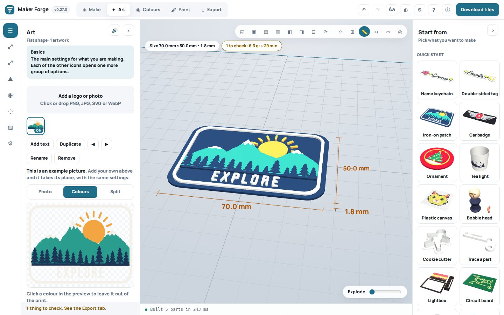

- **Add a logo or photo**: click the box or drop files on it. PNG, JPG, SVG and WebP all work. SVG files keep their real size.
- **Add text**: words in any of the fonts. The text is trimmed to its letters, so its width and height are the letters' own.
- **Make an icon** (new in 0.43): a multicolour icon from up to four of 54 simple icons (power, bolt, USB, Wi-Fi, fan, thermometer, drop, sun, warning, chip, gear and more) on a badge (circle, rounded square, hexagon, shield or none), with an optional ring and a word underneath. Start from an idea (**Power box**, **Cooling**, **Weather station**, **Smart home**…), or pick each icon from the grid (with a search box), its filament, size, place and turn. **A gap round icons laid over others** keeps a small icon on a big one readable. Each part prints in the filament you pick, and the icon follows your filaments if you change their colours. On a project box it goes on the lid as the lid logo (**Put it on the lid**). With **AI help** set up, **Design it with AI** puts one together from a description such as "a fan with a small snowflake, blue and white".

  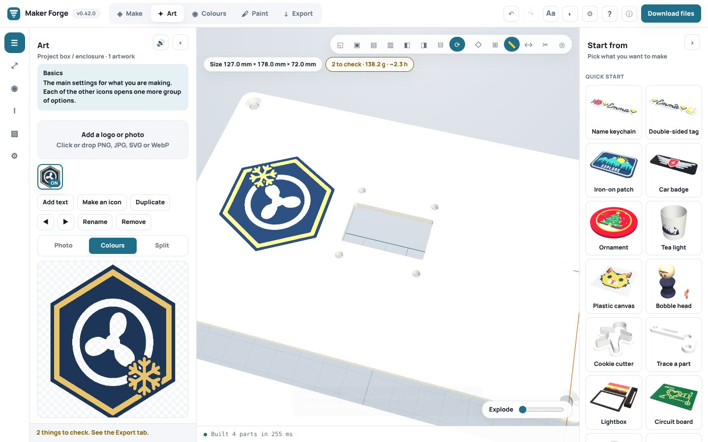
- The list shows every picture. Click one to select it; the buttons below duplicate, reorder, rename or remove it. When you add a new picture, the earlier ones are switched off so they do not land on top of each other; click a thumbnail to switch one back on.

**The preview** has three modes: **Photo** (the picture as it is), **Colours** (the picture split into your filaments, as it prints) and **Split** (half and half). Click a colour in the preview to leave it out of the print. The picture's background, the colour round most of its edge, is left out by itself and shows as a checked pattern; every other colour prints, right up to the picture's edge. A picture whose edge is already partly see-through (a cut-out, a PNG logo with clear corners, text) has nothing left out. A picture all in one colour is all background, and the Art tab says so.

**Size and place.** Set the width, the rotation and which side it goes on. Click the model in the 3D view to move the picture there, or nudge it with the arrow keys (0.5 mm, or 2 mm with Shift).

**Width** and **Height** go together: set either one and the other follows the picture's shape (a name 12 mm tall, say).

On the side of a round object (a cylinder, a sphere, a round pen pot, a vase), a picture is **wrapped round it** like a label: its width is measured round the curve and its height along the side, so a 50 mm picture goes 50 mm round and a 40 mm tall one reaches 40 mm up a sphere's surface. **Project it straight on** is the other choice, as from a projector: the picture then gets bigger where the surface turns away. That suits a small picture, or an imported model that isn't round; on imported models wrapping is there to choose too.

**How it prints:**

- **Flat colour**: each colour is a raised layer of one height. Best for logos and drawings.
- **Stepped**: each filament a little higher than the last, for depth.
- **Photo relief and lithophane**: brightness becomes thickness.

On an object, a flat or stepped picture can also be cut into it. Choose under **How it prints**:

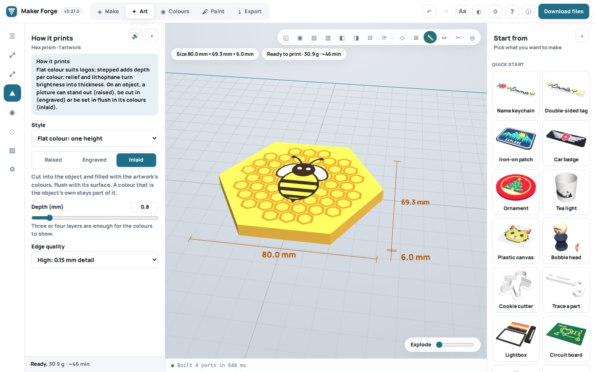

- **Raised**: the picture stands out from the surface.
- **Engraved**: the picture is cut into the surface, in the object's own colour. **Depth** sets how deep.
- **Inlaid**: the picture is cut in and filled with its own colours, flush with the surface. A colour that is the object's own stays part of the object. Three or four layers deep (0.6 to 0.8 mm) is enough for the colours to show.

This works on every object a picture can go on, imported models too. The first time, the app downloads its cutting tool (0.6 MB, checked before it runs). **Before you print** says when an engraving is deeper than the model is thick.

**Colours.** A picture prints in the filament closest to each of its colours. Where two colours meet, the blend between them takes one of the two, so no rim of a third filament runs round the letters (black on white blends to grey, which could be nearest a red). You can print it all in one filament, leave colours out, **Drop the background colour** (that filament everywhere in the picture), **Print the background too** (a patch of it round the picture, out to its edges), add an **outline** that holds separate pieces together, adjust brightness, contrast and saturation, and snap it to squares for a pixel look.

On some objects the picture *becomes* the object: a cookie cutter, a lightbox, a jigsaw, a tracer, a circuit board, a lithophane. Their size and shape are then set on the Make tab, and the Art tab shows only what they use.

**Taking a picture's background away.** A picture with a background shows buttons under the preview (a keychain's picture shows them on the Make tab too). Both trim the picture to what is left, so only that prints, and **Put the background back** returns the picture as it was.

- **✂ Take the background away**, for a logo or drawing on one plain colour (shown beside the button): it goes by its colour, straight away, with nothing to download. It also clears that colour inside the picture, such as the holes in letters, unless it is a big patch on white (the white inside a drawing's outline stays). **Inside it too** or **Only round it** switches that, and **How different a colour can be and still go** takes more or less. The edges stay smooth, in the picture's own colours, with no rim of the background.
- **✨ Cut out with AI**, for a photo, even one with a busy background, such as a pet on a sofa. The first time, it downloads the AI figure finder (about 19 MB, checked before it runs); after that it works straight away, and the picture never leaves your computer. The AI is made for photos: if it finds no subject in a picture on a plain colour, or can't be downloaded, the background is taken away by its colour instead.
- A badge or sticker: once its background is gone, what is left can sit on a patch of one colour. **Take the green round it away too** (or whichever colour it is) takes that off as well, so only what is on the patch prints. A picture that has a clear background already, on such a patch, shows the same button.
- **Take this colour away too** lists the picture's other main colours once its background is gone: click one and it goes everywhere in the picture (a white highlight, a second background colour), up to four.

**Tips for good pictures:** bold shapes and a few flat colours print best. Lines thinner than about two steps of the picture's **Edge quality** (half a millimetre at Standard) are dropped, because a nozzle could not print them; choose **High** or **Ultra** for fine lines. The colour round most of the picture's edge is taken to be its background and left out.

## 5. Colours: your filaments and your printer

**Loaded filaments.** One row per spool: its colour, name, material and price per kilo. Set these to the spools you really have loaded; slot 1 is the first spool in your AMS or first extruder. **Add filament** goes up to eight. **Palettes** fill in a set of colours at once, and **Match to artwork** picks colours from the selected picture.

**Printer.** Choose your printer from the list (39 models, grouped by maker). It sets the bed size, the nozzle and how many colours the printer loads at once, and the app remembers it for every new project. For a printer that loads one colour at a time, the Export tab lists the layers at which to pause and swap the spool by hand (see **Colour swap heights** in section 7).

## 6. Paint: colouring a whole model

The **Paint** tab colours the whole surface of a model, made here or imported (STL, OBJ, 3MF, GLB or glTF). It works in up to eight filaments.

**Models that come with colours.** Models from AI model makers (Meshy, Tripo, Rodin and others), from scans and from most 3D apps often carry their colours, as a GLB file, or an OBJ with colours on its corners or an MTL file and a picture. Choose **Import a model** in the Start from sidebar (or **Open a different model** on the Make tab). For an OBJ with an MTL file and pictures, choose the OBJ, the MTL and the pictures together. The model opens already painted: the step **The model's own colours** turns its colours into as many filaments as your printer loads.

- **Number of colours** sets how many filaments it uses.
- **Set my filaments to its colours** changes your loaded filaments to match the model; **Use my loaded filaments** keeps your spools and paints each part in the nearest one.
- **Tidy single stray triangles** removes lone specks of colour that would each cost a colour change.

GLB files are measured in metres; the app turns them into millimetres. A model that would be smaller than 10 mm or bigger than 500 mm across is made 80 mm across, and the app says so; change the size on the Make tab. Compressed GLB files (Draco or meshopt) cannot be opened: export them again without compression.

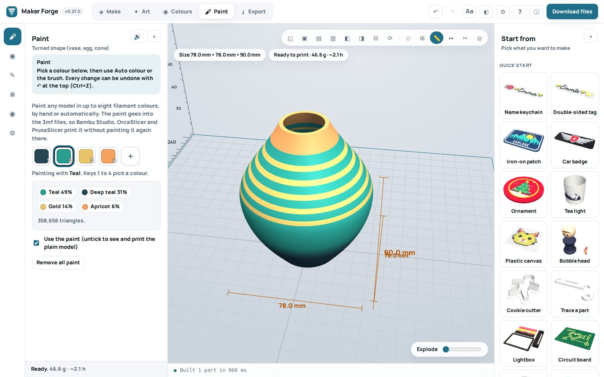

**Auto colour** paints the model for you, and follows it when its size or shape changes:

- **Height bands**: colours stacked in layers.
- **Colour fade**: one filament fading into another, layer by layer.
- **Stripes**, **tops and sides**, **separate pieces**, **smooth areas** split at sharp edges.
- **Edges and hollows**: ridges in one colour and hollows in another, for worn paint, stone and wood.
- **A picture**, projected through the model, wrapped round it like a label, or over it like a map on a globe.
- **Random blobs**, for camouflage or planets.
- **From a photo of the model**: drop a photo of a real figure and the app lines it up and colours the model from it. If the background is busy, **Find the figure with AI** (a one-time download of about 19 MB) finds it for you. If the AI finds no clear figure in a photo, the outline found by its colours stays, and the card says so.

**Light and shadow.** A photo lit from one side shows one paint as two colours: red in the light and almost black in the shade. With **Even out light and shadow** (on for new photos) the app works out where the light came from, using the model's own shape, and evens it out before reading the colours. The card says where it found the light. Pixels too dark to read are left out, and those parts take the colour round them.

**Photos taken close up.** A phone held near a small figure makes the parts nearest it look bigger: the head of a figure photographed from above, or the front of its base. When a photo is lined up, the app also works out how close the camera was and allows for it; the photo card says what it found ("taken from about 1.7 times the model's height away"). If it guessed wrong, choose **How close was the camera?**: **Far away or zoomed in**, **Arm's length** or **Close up**, or **Work it out** again.

**Following the model's shape.** With **Follow the model's shape** (under **Finishing**, on for new photos) the colours are worked out for the whole model at once rather than one little triangle at a time. Edges between colours settle into the model's own folds and seams (a hem, the top of a sock, the line round a boot), ragged edges and stray specks go, and the parts no photo sees take the colour on the other side of the same part: the back of a leg from its front, the back of a sleeve from its front. On a big model this takes a few seconds, while you carry on.

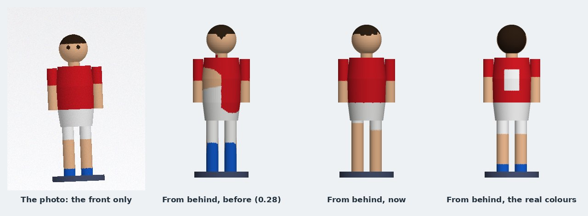

**A photo whose figure stands a little differently.** A drawing or an AI-made picture of the figure rarely has exactly the model's pose: the legs a little wider, the arms a little lower. When the figure was found with the AI (or fixed by hand), **Bend the photo a little to fit the model** (on by default) bends the photo by a few pixels so its outline meets the model's before the colours are read; the card says how much closer the outlines came ("the outlines overlap 96%, from 82% as lined up"). The colours themselves are still picked from the photo as it is.

**Tips for a good result.** The photo works best when it shows the very model you imported. If the picture has a second figure or other things touching the figure, paint them out with **Take away** (below) and press **Line it up again**. One photo only shows the front: the back is a good guess at best, so add a photo of the back if you have one, or touch it up with the brush and fill. With few filaments, dark details such as an open mouth or dark hair take the darkest colour there is; one more colour, or the brush, sorts that out.

**Click to colour** (new in 0.44): the quickest way to fix what the photo got wrong, or to colour a model part by part. On the photo card, choose **✨ Click to colour** and click on a part of the photo: the shirt, the hair, a boot. An AI (Segment Anything) outlines it in pink; click more of it to add (a second boot, the other sleeve), or choose **Click leaves out** (or Alt-click) to take a bit away. Pick a filament under **Paint it in** and press **Paint it**: the part of the model the outline covers takes that filament. **Right through** paints the back of that part too, as seen from straight behind (good for a shirt or shorts from a front photo). Each painted outline is a step on the **Paint list**, kept with the project, and it follows the photo if you line the photo up again. The first click downloads the AI (14 MB, once, checked before it runs) and reads the photo, which takes a few seconds; every click after that takes a fraction of a second. It all runs on your computer: the photo is not sent anywhere.

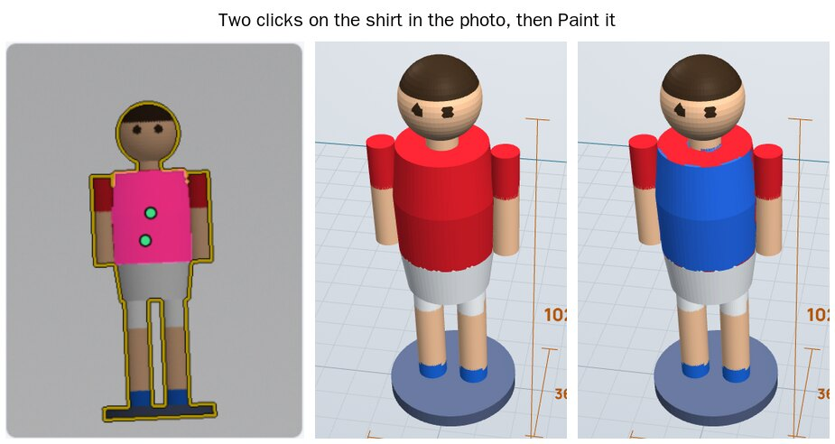

**Fixing the figure by hand.** On the photo card, **Figure it found** darkens everything the app takes for background. If it took in some background, or missed a part of the figure, choose what dragging on the photo does: **Take away** paints background out, **Add to the figure** paints a missed part in. Start with a big brush away from the figure, then use a small one near its edges. The colours use your fixes straight away; press **Line it up again** to line the photo up with them too. **Undo the last fix** and **Clear my fixes** take them off, and **Move the photo** goes back to dragging the photo into place. The fixes are saved with the project.

**Brush and fill** paint by hand:

| Tool | Key | What it does |
| --- | --- | --- |
| Brush | B | Paints where you drag. It lights up what it will paint before you press. |
| Fill | F | Fills one smooth area. |
| Eraser | E | Takes paint off. |
| Pick colour | I | Takes a colour from the model. |
| Recolour | R | Changes every part of one colour into another. |
| Box or lasso | A | Paints everything inside a box or a loop you draw: the side you see, or right through. |
| Move the view | V | Drag turns the model instead of painting. The **✋ Move** button in the view does the same and takes you back to your brush. |

**Moving while you paint** (new in 0.43): you don't need to switch tools. Drag **beside the model** to turn it, **right-drag** to turn it too, **hold Space** and drag anywhere, drag with the **middle button** to slide it, and **scroll** to zoom. On a touch screen, one finger beside the model turns it and two fingers zoom and slide; a stroke you started just before putting the second finger down is taken back. The view stops gliding the moment you start painting, so a stroke made straight after turning lands where you put it.

Keys **1** to **8** pick a filament, **[** and **]** make the brush smaller or bigger. **Mirror** paints both sides at once, **Repeat round the middle** copies each stroke 2 to 12 times round the model, and the **smart brush** stops at sharp edges.

**Paint list** shows every step in order; a later step paints over an earlier one. **◉** hides a step for now: it is left out of the model and the print until you press **◌** to show it again, and the Export tab reminds you. **✎** gives a step a name, such as "Eyes" or "Hair"; press Enter to keep it or Escape to leave it as it was. **Layers and colour changes** counts how many times the printer swaps colour, how much filament that flushes away and how long it takes, and can cut the model open at any layer. **Paint detail** decides how finely the model is split: finer follows small shapes better but makes bigger files. **Sharp edges** (on unless you turn it off) cuts each brush stroke, eraser stroke and painted picture into the model, so a colour ends exactly where you painted it rather than at the nearest triangle: a round dab prints round and a picture's colour edges run where the picture's do, even with coarse detail. A big model is cut a moment after you stop painting, and always before a download; until then it shows the triangles painted as before.

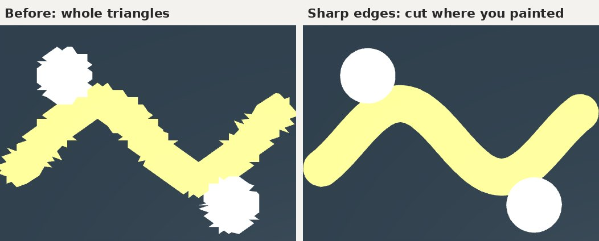

The paint goes into the 3mf files as slicer paint, so there is nothing to paint again in Bambu Studio, OrcaSlicer or PrusaSlicer.

## 7. Export: checks and files

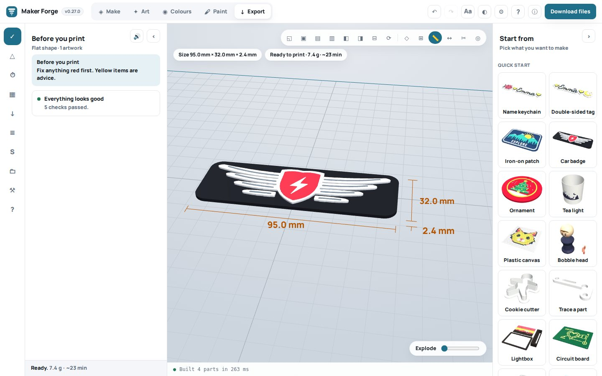

**Before you print** lists what the app checked: that every part is closed, fits on your bed, has no walls thinner than your nozzle, uses no more colours than your printer loads, and so on. Fix anything red first; yellow items are advice. The **Printability** page shows where the model needs support, and **Optimize** turns it to need the least.

**Material and time** gives the grams, metres and cost of each filament and a rough print time.

**Colour swap heights** is for printers that load one colour at a time. It lists the colour to start with, then each layer where the printer should pause so you can load the next spool. Painted colours count too: each height band or stripe is a swap. To add the pauses:

- **PrusaSlicer**: slice, move the layer slider in the preview to each height and click the **+** beside it.
- **Bambu Studio** and **OrcaSlicer**: slice, move the layer slider to each height, right-click it and choose **Add pause** (or **Change filament**).

The heights are the top of the first layer in the new colour, as the slider shows them. A layer that has two colours at once (the foot of a name sunk into its plate, say) prints in the colour already loaded. A colour that only ever shares its layers with another, such as a spot of paint on the side of a vase, can't be printed this way: the check names it, so print it as a separate part or paint it in bands.

**Files.** **Download print files** makes a zip with:

- `model-bambu.3mf` for Bambu Studio (drag it in and choose **Import geometry only**), and `model-prusa-orca.3mf` for PrusaSlicer and OrcaSlicer, with every part assigned to its filament;
- a coloured OBJ, one STL per filament and one merged STL;
- printing notes and the project file;
- for a one-colour-at-a-time printer, `colour-changes.txt`: where to pause and which spool to load;
- for a project box made in parts, a pair of 3mf files for each plate (`plates/plate-1-bambu.3mf`, `plates/plate-1-prusa-orca.3mf` and so on), an STL for each part, and `how-it-goes-together.txt`. Print the plates one at a time; the model files above hold every plate side by side.

Also on this tab: **A keychain for every name**, **Share a link**, the **Project file** buttons and **Slicer notes**.

## 8. The 3D view

- **Drag** to turn the model, **right-drag** (or two fingers) to move it, and **scroll** (or pinch) to zoom.
- On the Art tab, **click the model** to move the selected picture there.

The buttons above the model:

| Button | What it does |
| --- | --- |
| ◱ ▣ ▤ ▥ ◧ ◨ ⊟ | Look from an angle, from above, the front, behind, the left, the right or below |
| ⟳ Turn over | Shows the model upside down, to see the side that prints on the bed (the files do not change) |
| ◇ Wireframe | Shows the triangles |
| ⊞ Layout | Lays the parts out as they print, side by side |
| 📏 Rulers | Shows the size on the model |
| ↔ Measure | Click two points to measure between them; it snaps to corners |
| ✂ Section | Cuts the model open at a height, to look inside |
| ◎ Save a picture | Downloads a PNG of the view |

On a narrow screen the seven view buttons fold into one, **◱▾**, which opens them.

The **Explode** slider pulls a model with several parts apart.

The view is only drawn again when something changes, so an open Maker Forge left alone does not keep your computer's or phone's graphics busy. Clicking or brushing on a big model is quick however many triangles it has, and the printability check works in the background while you carry on.

## 9. Saving, opening and sharing

- Your work is **saved in this browser** as you go, and comes back when you open the app again. Settings can turn this off.
- An **imported model** is kept in this browser too (the last four, up to 300 MB), so it comes back with your work, from the recent list and from a share link opened in the same browser. It never leaves your computer. **Clear saved work in this browser** in Settings forgets them.
- **Ctrl+S** (or **Save project** on the Export tab) downloads a project file (`.json`) with everything in it, pictures and imported models included. **Open project** opens one again. The last three projects you saved or downloaded files for are listed there too, to open with one click.
- **Share a link** puts your design in a link to send to someone. Pictures are left out of links; send the project file for those.
- **Start over** clears everything for a new project.

## 10. Easy reading

The **Aa** button in the top bar:

- makes all text and buttons bigger, up to 175%;
- switches on high contrast;
- uses Atkinson Hyperlegible, a font drawn for people with low vision;
- keeps messages on screen longer, or until you click them, and can read them aloud;
- can put a **pattern** on each filament (stripes, dots, hatching) on the model and the swatches, so colours can be told apart without seeing colour.

The **🔊** button reads the open page aloud. Everything can be reached from the keyboard: Tab moves between controls and the arrow keys move between tabs and page icons. Your Easy reading choices are kept in this browser.

## 11. Keyboard shortcuts

| Keys | What they do |
| --- | --- |
| Ctrl+Z | Undo |
| Ctrl+Shift+Z or Ctrl+Y | Redo |
| Ctrl+S | Save the project file |
| Delete | Remove the selected picture (Art tab) |
| Arrow keys | Nudge the selected picture 0.5 mm (Art tab); with Shift, 2 mm |
| 1 to 8 | Pick a filament (Paint tab) |
| [ and ] | Smaller or bigger brush (Paint tab) |
| B F E I R A V | Brush, fill, eraser, pick colour, recolour, box or lasso, move the view (Paint tab) |
| Escape | Close a window |

On a Mac, use Cmd instead of Ctrl.

## 12. Printing tips

- **Flat pieces** print face down on the bed with no supports.
- **Iron-on patches** in TPU flex with the fabric. **Car badges** in ASA or PETG: PLA softens in a hot car. **Keychains** in PETG last longer in a pocket.
- **Lithophanes** print standing up, in white PLA at 100% infill. Light them with an LED only.
- **Tea lights and lamps**: LED tea lights only, never a real flame.
- **Jigsaws** print assembled: snap the pieces apart afterwards. A gap of 0.2 to 0.3 mm suits a 0.4 mm nozzle.
- **Phone cases** print in TPU so they snap on. Print the fit test rim first.
- **Bobble heads**: print the spring in TPU.
- **Mains boxes**: use a certified, enclosed power supply module, earth the inlet and print in PETG or ASA.
- **Cookie cutters**: PETG, two walls, no infill. Wash by hand.
- **Colour changes cost filament.** A picture with many small colour areas across many layers flushes a lot of filament on an AMS. The Paint tab's Layers page shows how much before you print.

## 13. When something goes wrong

**"Things to check" in the status line.** Open the Export tab: each item says what is wrong and what to do.

**The picture prints in the wrong colours.** Each colour goes to the nearest filament. Set your filaments on the Colours tab to what you have loaded, or leave colours out on the Art tab.

**Part of the picture is missing.** The colour round most of the picture's edge is taken as its background and left out (the preview shows it as a checked pattern); tick **Print the background too** to print it. Very thin lines (under about two steps of the picture's **Edge quality**) are also dropped, because the nozzle cannot print them: a higher **Edge quality** keeps them.

**The model looks empty.** Some objects are made from a picture (cookie cutter, lightbox, jigsaw, tracer, circuit board, lithophane): add one on the Art tab.

**An opened project has no model.** Projects saved in the browser and share links leave out imported models. Open the same model file again and its paint comes back.

**"Could not build the model" or "This artwork could not be laid on the model".** The message says what went wrong and where. Undo (Ctrl+Z) takes back the last change; artwork that cannot be laid on the model is left out until you move or remove it on the Art tab. If it keeps happening, a screenshot of the message helps the developers find it.

**"Maker Forge could not start".** A website that serves Maker Forge with very strict security settings can block the part of the app that makes the shapes. Download `index.html` from GitHub (or a version from the Releases page) and open that file instead.

**"This model has gaps in its surface, so it can't be cut".** Engraving, inlays and **Cut it flat** need a closed model. Until then the picture is shown raised. Repair the model and open it again: in Bambu Studio or OrcaSlicer, right-click it, choose **Fix model**, and export it as STL or 3MF.

**"The cutting tool could not be downloaded".** Engraving, inlays and cutting flat download a small tool once (0.6 MB). Check the internet connection, then change any setting to try again. A website that blocks downloads from other sites needs `manifold.js` and `manifold.wasm` in a `models` folder next to `index.html`.

**"The AI figure finder could not be loaded".** It downloads once from the internet (about 19 MB). A website that blocks downloads from other sites needs its files in a `models` folder next to `index.html` (the file `models/LICENSE.md` on GitHub says which). Finding the figure by colour, and the downloaded `index.html`, work without that.

**I want an earlier version.** Every version is on the [Releases page](https://github.com/Retr0Plus95/Maker-Forge/releases) (also linked from About, ⓘ). Download the file of the one you want and open it in your browser. Projects saved in one version open in later ones.

**The app feels slow.** In Settings, lower **Maximum preview detail**. On the Paint tab, choose coarser **Paint detail**. Some websites do not let the app use a helper thread, so the printability check works on the page itself there and changes take a little longer than in the downloaded file.

**My slicer shows one colour.** Open the 3mf that matches your slicer (see Export → Slicer notes). In Bambu Studio, if the 3mf will not open, import `model.obj` and accept the colour dialog.

**Bambu Studio says "The 3mf is not from Bambu Lab, load geometry data and color data only".** That is normal: Bambu Studio says it about every 3mf made by another app, and the model, its paint and each part's filament still load. To skip the message, drag the file in and choose **Import geometry only** (or use File → Import). Your own printer and filament settings stay as they are, so set the filament colours in Bambu Studio's filament list.

## 14. Privacy

Maker Forge runs entirely on your computer. Your pictures, photos, models and projects are never uploaded. The page loads three code libraries from jsDelivr, a public service for open-source code, so that service sees the page was opened; the fonts are built in. The AI figure finder and the cutting tool download only when you ask for them, and run on your computer too. There are no accounts, no tracking and no adverts. **AI help** is off unless you set it up: then the words you type for it go to Anthropic (with your own key) or to Ollama on your own computer (below).

Maker Forge is open source under the MIT licence.

### AI help

Optional, and off until you set it up in **Settings (⚙) → AI help**. It powers **Plan it with AI** for project boxes and **Design it with AI** in the icon maker. Without it, both still work from the words you type and the ready-made ideas.

- **Claude (your API key):** paste a key from console.anthropic.com. Using it is billed to your Anthropic account. The key goes only from this page to Anthropic; it is never put in a project, a share link or an exported file. It is forgotten when you close the page unless you tick **Remember the key in this browser**. **Model** is `claude-opus-5-5` unless you change it.
- **On this computer (Ollama):** free and offline. Install Ollama from ollama.com, run `ollama pull llama3.2` (or another model, named under **Model**), and let this page talk to it: set the `OLLAMA_ORIGINS` setting to this page's address (shown in Settings) and restart Ollama. Small models make more mistakes.
- **Test it** asks for a one-line hello, to check it works.
- What is sent: the words you type, the lists of board, opening and icon names, and your filament colours. Never pictures, models or projects. The AI never makes the shape itself: it answers with names from the app's lists, every value is checked like a project file, and the app lays everything out.
- On a website with strict security settings the AI may be blocked; the downloaded file always works.
