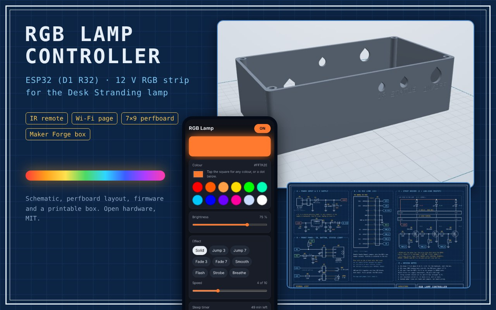
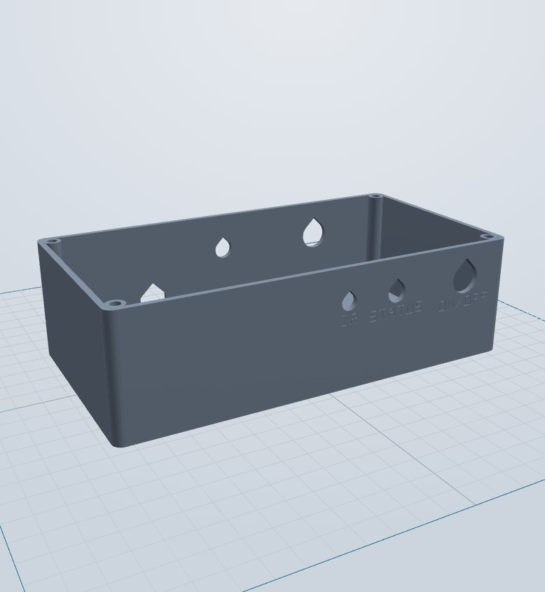
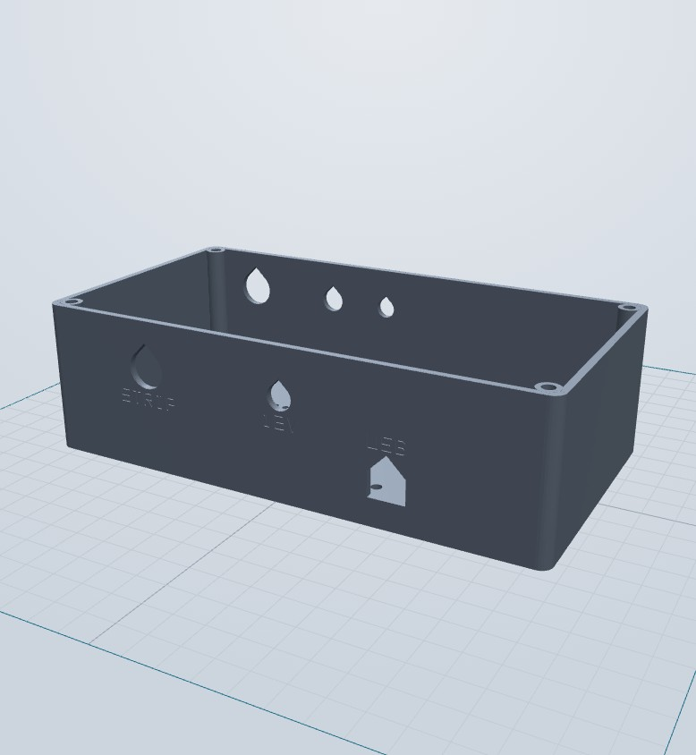
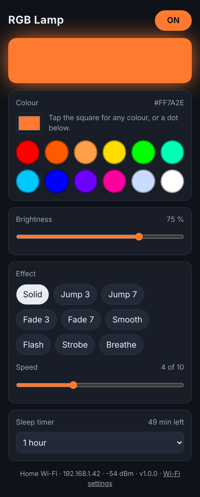
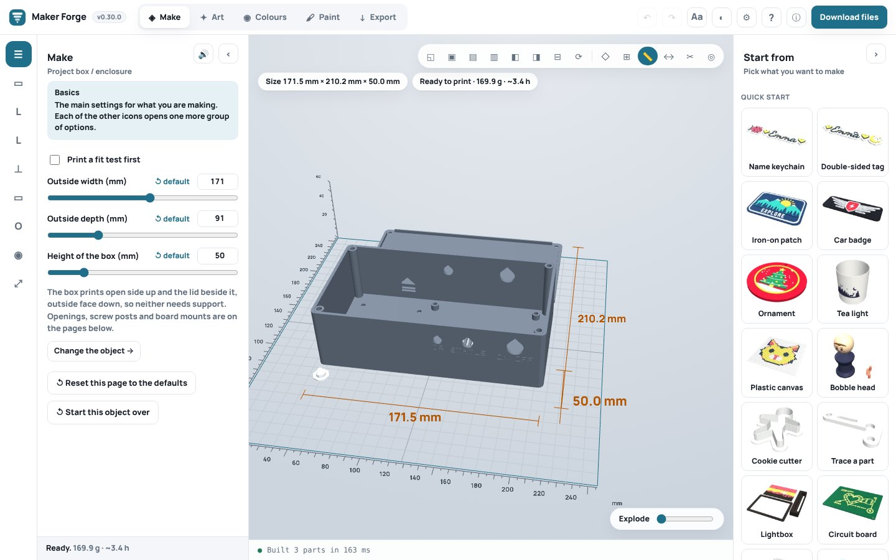
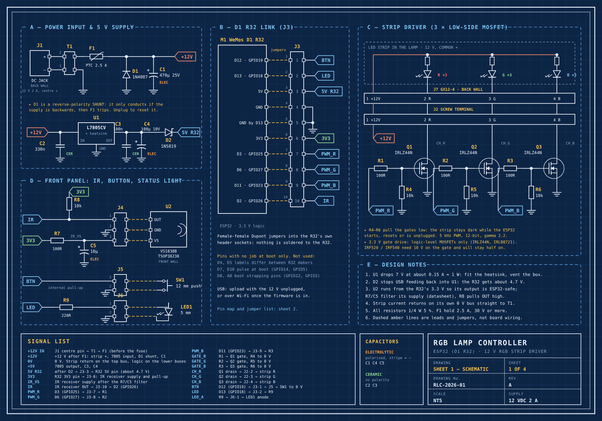

# RGB Lamp Controller



An ESP32 controller for the 12 V RGB LED strip in the 3D-printed **Desk Stranding** lamp (the
[Death Stranding desk lamp on Printables](https://www.printables.com/model/40386-desk-stranding-the-death-stranding-desk-lamp)).
A WeMos D1 R32 drives the strip through three logic-level MOSFETs on a 7 × 9 cm perfboard, in a project box made
with [Maker Forge](https://github.com/Retr0Plus95/Maker-Forge). Control it with the cheap IR remote that comes with
RGB strips, one push button, or a web page on your phone.

## Features

- WeMos D1 R32 (ESP32 in Arduino Uno size), jumpers into its header sockets: nothing soldered to it
- 3 × IRLZ44N low-side MOSFETs, 5 kHz 12-bit PWM with gamma correction, smooth fades
- Strip stays dark while the ESP32 boots (gate pull-downs)
- 24- and 44-key IR strip remotes, with DIY colour memories; codes of other remotes printed on the serial monitor
- Push button: on/off, next effect, dimming; hold at power-up to reset Wi-Fi
- Phone web page served by the lamp: colour picker, brightness, 9 effects, speed, sleep timer — nothing loaded
  from the internet; set-up network for the first Wi-Fi connection; `http://rgb-lamp.local/`
- Remembers its colour through a power cut; firmware updates over Wi-Fi
- 12 V input with a resettable PTC fuse and reverse-polarity shunt diode; 7805 + Schottky for the R32's 5 V
- No third-party Arduino libraries
- Printable box from Maker Forge: no supports, engraved labels, a printed jewel lens for the status light

| | |
|---|---|
|  |  |
|  |  |

## Project status

Designed and checked, not yet built. The firmware's logic is unit-tested and the sketch compiles for the D1 R32;
the web page is tested in a browser; the perfboard layout is checked against the netlist by a script; the box is
built and checked by Maker Forge (no supports, every part closed) and checked for clearances. A real build,
real remotes, Wi-Fi on the board and the printed fit are the next step: see the build guide's §16.

## Documentation

[`docs/Build_Guide.md`](docs/Build_Guide.md): parts list, every connection, the MOSFET and power stages, the perfboard
build order, a step-by-step bring-up, programming, Wi-Fi set-up, the remote, the box and troubleshooting.

| Sheet | Drawing |
|---|---|
| RLC-01 | [Schematic](docs/schematics/RLC-01_Schematic.png) ([SVG](docs/schematics/RLC-01_Schematic.svg)) |
| RLC-02 | [Reference: R32 pins, jumpers, panel leads, remote keys](docs/schematics/RLC-02_Reference.png) ([SVG](docs/schematics/RLC-02_Reference.svg)) |
| RLC-03 | [Perfboard layout and wire list](docs/layout/RLC-03_Perfboard_Layout.png) ([SVG](docs/layout/RLC-03_Perfboard_Layout.svg)) |
| RLC-04 | [Box and wiring](docs/layout/RLC-04_Box_Wiring.png) ([SVG](docs/layout/RLC-04_Box_Wiring.svg)) |



## Repository layout

```text
firmware/RGBLampController/  Arduino sketch: RGBLampController.ino, config.h, lamp_core.h, web_page.h
test/                        host tests for lamp_core.h (make -C test) and the web page test (Chromium)
hardware/                    netlist, perfboard layout, layout and box checks, drawing generator
docs/Build_Guide.md          the build guide
docs/schematics, docs/layout the RLC-2026 drawing set, SVG and PNG
enclosure/                   the box: design, Maker Forge project, 3MF and STL files, build and render scripts
images/                      pictures for this README and the website
```

## Firmware

[`firmware/RGBLampController`](firmware/RGBLampController): Arduino IDE 2 with **esp32 by Espressif Systems** 3.x,
board **WEMOS D1 R32**. Set your own passwords in `config.h` first. Details in the build guide, §9–§12.

## The box

Made with Maker Forge's project box generator by [`enclosure/make_box.js`](enclosure/make_box.js) from
[`enclosure/box-design.json`](enclosure/box-design.json). Print
[`rgb-lamp-controller-box-bambu.3mf`](enclosure/rgb-lamp-controller-box-bambu.3mf) (Bambu Studio, OrcaSlicer) or
[`rgb-lamp-controller-box.3mf`](enclosure/rgb-lamp-controller-box.3mf) (PrusaSlicer), or the STL files. To change it,
open [`rgb-lamp-controller-box.forge.json`](enclosure/rgb-lamp-controller-box.forge.json) in Maker Forge, or the link in
[`enclosure/share-link.txt`](enclosure/share-link.txt).

## Checks

```
make -C test                       # firmware logic, 56 checks
node test/web_page_test.js         # the phone page in Chromium (Playwright)
python3 hardware/check_layout.py   # perfboard layout against the netlist
python3 hardware/check_box.py      # panel parts clear the boards and the lid
python3 hardware/draw.py && node hardware/render_png.js     # redraw the drawing set
node enclosure/make_box.js         # rebuild and check the box (needs a Maker Forge checkout beside this one)
arduino-cli compile --fqbn esp32:esp32:d1_uno32 firmware/RGBLampController
```
A GitHub Action runs the tests, the checks and the compile on every push.

## Safety

12 V at 2 A can't shock you but can start a fire through a shorted wire: keep F1, use a proper enclosed 12 V
adapter, and print the box in PETG (the 7805 makes about 1 W of heat). Read the build guide's §2 and do the
bring-up in §8 before closing the box.

## License

MIT. The lamp itself is not part of this repository: get it from its Printables page.
